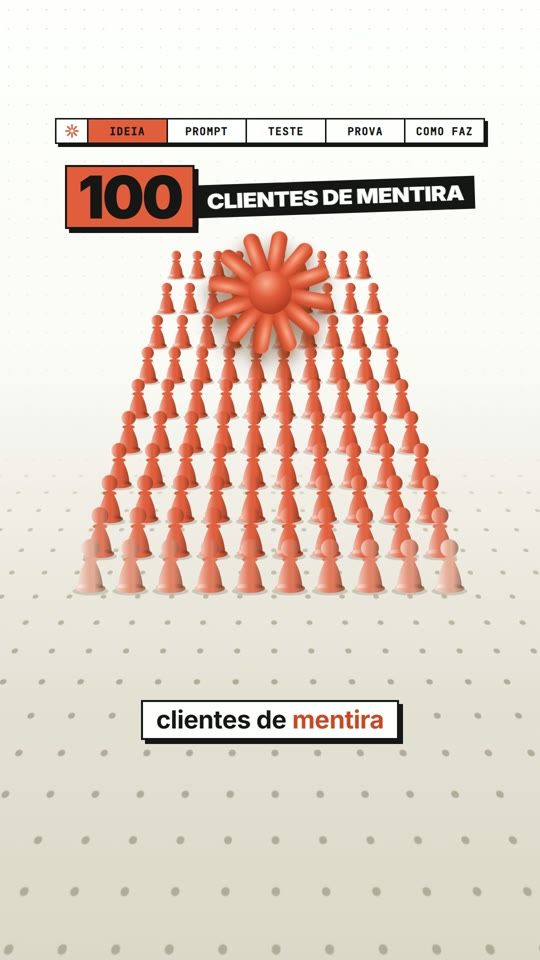
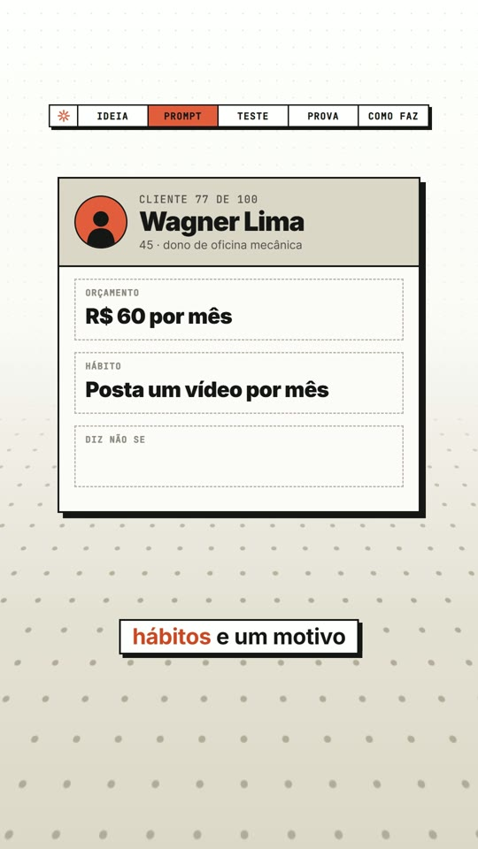
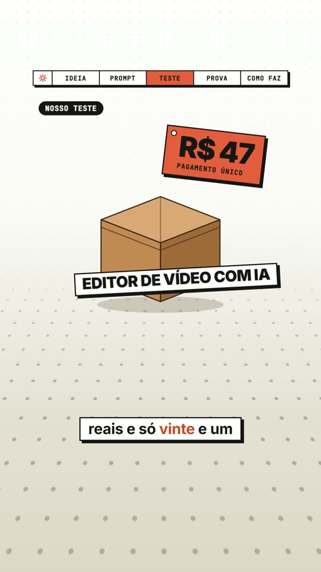
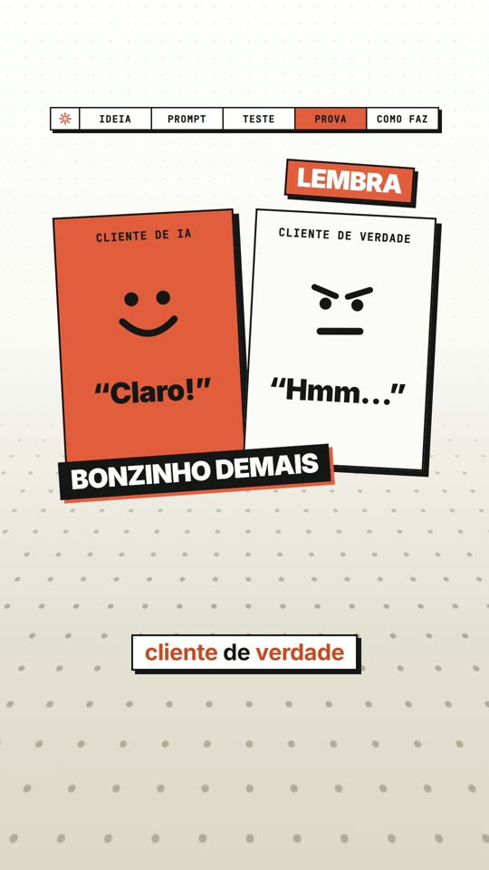

# Estilo Colagem

Vídeo só de animação, sem a pessoa em cena, sobre a voz: **colagem editorial clara**. Abas de capítulo no topo, cartões recortados de contorno preto grosso e sombra dura, etiquetas que batem na tela, carimbos, recibos, multidão de bonecos e alguns objetos em 3D, sobre um fundo claro com um chão em perspectiva. Bom para explicar um método ou contar um teste com números ("testei em 100 clientes e só 21 compraram"), em vídeos rápidos de 40 a 60 s.

   

## A voz

Gravada pela pessoa ou de IA (ver [voz-de-ia.md](../referencias/voz-de-ia.md)). **Gravada pela pessoa:** o áudio do celular (o gravador de voz serve; m4a, mp3 ou wav), posto em `brutos/`. Ele passa pelo `transcrever` e pelo `cortar`, como um vídeo: saem as pausas, entra o tratamento de voz, e o vídeo de base é preto, com a duração exata da voz. O tempo de cada palavra é o da gravação. Com a voz dela, peça para gravar num ritmo animado: o estilo pede fala rápida. Um pouco mais rápida que no Motion: com voz de IA, `"velocidade": 1.08` no `meu-estilo/marca.json`.

## Na tela

- **Fundo com profundidade** (`mc-fundo.html`, do início ao fim): a metade de cima quase branca, com pontos leves; da metade para baixo, um chão em perspectiva, com os pontos maiores perto da borda de baixo, andando devagar. O mesmo arquivo traz as **abas de capítulo** no topo, que acendem a cada parte do vídeo: em `"marcas"`, uma palavra para cada troca de aba. Troque os nomes das abas pelas partes do roteiro (4 a 6 palavras curtas).
- **Uma troca de quadro a cada 1 ou 2 s**, quase sem corte: o quadro novo entra num pulo curto e o anterior sai rápido (`quadro()`).
- **Cartões de colagem** (`.mc-cartao`): fundo de papel, contorno preto grosso e sombra dura deslocada. Fichas de pessoa com retrato e carimbo, recibo, cartão com o pedido digitado, balão preto de fala.
- **Etiquetas inclinadas** (`.mc-et`, com `cola()`): batem na tela e achatam. Laranja para o assunto, verde para o que é bom (comprou, de graça, fácil), vermelha para o não, preta para a virada ("a parte mais louca").
- **Carimbos** (`carimbo()`) e **contagem:** a grade de bonecos (`grade()`), a roda que recebe a ideia com o contador, os cartões verde e vermelho, as barras do porquê.
- **Objetos 3D** (no `mc-base.js`): o peão (`PEAO`), em fileiras de perspectiva, que acendem em onda; o asterisco 3D (`ASTER3D`), sempre na frente do que estiver atrás dele; e, nas cenas de exemplo, a caixa que cai e o pedestal.
- **Legenda** numa caixa branca de contorno preto, com a frase curta inteira e as palavras-chave em laranja: `"legenda": {"modo": "karaoke", "classe": "leg-caixa", "x": 150, "largura": 780, "y": 1400, "caracteres": 22, "destaques": [...]}`.
- **Longe das laterais:** tudo (abas, cartões, etiquetas, a fileira da frente dos peões, a legenda) a uns 150 px das bordas, porque o Instagram aproxima o vídeo ao postar e corta o que encosta.
- **Contraste:** texto pequeno branco no laranja não passa no conferidor de leitura (a aba acesa leva texto preto). Etiqueta grande pode ter texto branco.
- **Números e falas de verdade:** se o vídeo conta um teste, os números e as falas na tela saem do teste que a pessoa fez, nunca inventados.

## Som

Pouco efeito: uma etiqueta batendo, um carimbo, o objeto caindo, o clique do final, um swish na troca de aba. Sem música. Com voz de IA, `"efeitos": {"ganho": -6}`.

## Como montar

1. A voz, já na velocidade do estilo, em `.projetos/NOME/corte/` (`voz` com a de IA; `transcrever` e `cortar` com a gravada).
2. No `roteiro.json`: `mc-fundo.html` do início ao fim (com as marcas das abas) e uma cena por aba (os exemplos são `mc-ideia.html`, `mc-prompt.html`, `mc-teste.html`, `mc-prova.html` e `mc-fim.html`), todas com `"som": false` e os efeitos em `"sons"`.
3. Em cada cena, `<!--#inclui mc-base.css-->` no `<style>` e, no `<script>`, `<!--#inclui mo-base.js-->` seguido de `<!--#inclui mc-base.js-->`.
4. `montar`, olhar os quadros (bordas, sobreposições, a ordem do 3D), `renderizar`, `finalizar`.
