# Estilo Curta 3D

Rascunho (2026-11-20).

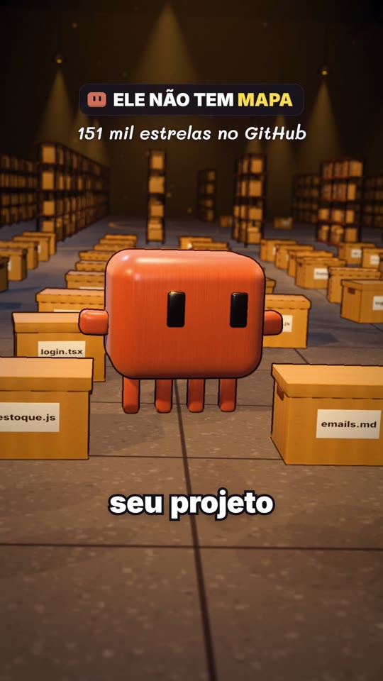 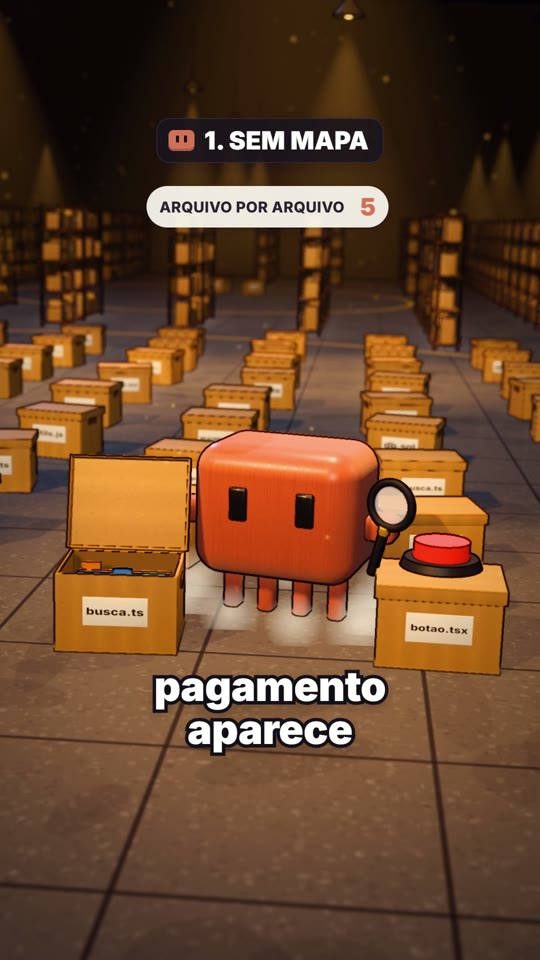 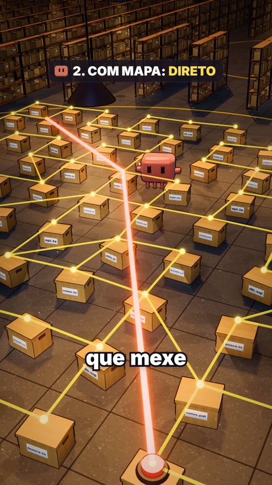 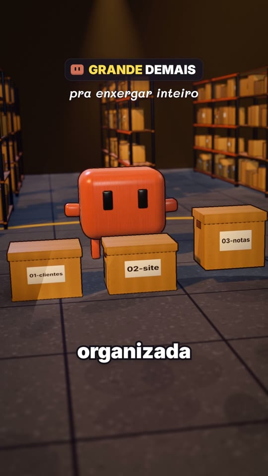

Os quadros acima são do vídeo do graphify ("O Claude não se perde por burrice").

Vídeo só de animação, sobre a voz da pessoa (gravada ou de IA): um **curta num mundo 3D de brinquedo com acabamento de filme**. Tem contorno fino nas peças, fundo desfocado, brilho só no que acende, sombra de contato, cor tratada e uma câmera que nunca para: ela corta entre os blocos, desliza e sacode nos impactos. Cada vídeo é **uma metáfora num mundo de maquete**: no vídeo do `/btw` do Vitório, uma ferrovia de brinquedo num fim de tarde, em que o trem é a conversa e o Claude dirige a locomotiva. Serve bem para vídeo que ensina uma ferramenta ou um conceito em 40 a 70 s.

**Diferente dos outros estilos**, este não passa pelo `montar` do HyperFrames. A cena é montada no three.js e gravada pelo **Remotion**, num projeto próprio em `.projetos/NOME/`, copiado do molde do kit. A voz, a legenda, os efeitos sonoros, a régua de volume, a escuta e o `finalizar` são os mesmos do produto.

## O kit

Fica em `.ferramenta/skill/referencias/curta3d/`:

| Pasta | O que tem |
|---|---|
| `molde/` | O projeto-modelo do Remotion, para copiar para `.projetos/NOME/`. O motor fica em `src/motor/` (não mexa). O vídeo fica em `src/cena.tsx` (aceita JSX, para os cartões), o único arquivo que muda de um vídeo para outro. Ele vem com o exemplo do curta comum; o do Estilo Conversa está em `exemplos/conversa.tsx` (copie por cima do `src/cena.tsx`) |
| `pecas/glb/` | As peças 3D prontas, uma por arquivo |
| `pecas/imagens/` | Uma imagem de cada peça, no acabamento do estilo |
| `pecas/blender/` | `estilo.py`, com a paleta e as ferramentas de modelagem, e `pecas.py`, com o script que gera cada peça do kit |
| `LICENCA-cartoon-3d-short.txt` | O aviso de autoria do código de acabamento (MIT) |

### As peças prontas

Todas em metros, na escala real, com o pivô no chão e a frente para +Z. Na lista, a parte entre parênteses é o nó que mexe ou que recebe texto.

| Peça | Tamanho (L x P x A) | Partes |
|---|---|---|
| `claude` | 1,36 x 0,75 x 1,07 | corpo (`claude_corpo`), olhos (`claude_olhos`), braços (`claude_bracoE/D`), quatro pernas (`claude_perna0..3`) |
| `pessoa`, `pessoa_b` (cabelo comprido) | 0,81 x 0,45 x 1,84 | cabeça, olhos, braços e pernas. Cores que se trocam pelo nome do material: `pele`, `roupa`, `calca`, `cabelo`, `sapato` |
| `computador` | 0,74 x 0,53 x 0,79 | tela (`computador_tela`), teclado e mouse |
| `notebook` | 0,46 x 0,40 x 0,32 | tampa (`notebook_tampa`, gira em x), tela (`notebook_tela`) |
| `celular` | 0,08 x 0,01 x 0,16 | tela (`celular_tela`). Como protagonista, use com escala de 4 a 8 |
| `mesa` | 1,40 x 0,75 x 0,75 | tampo a 0,75 m |
| `caixa_arquivo` | 0,44 x 0,34 x 0,30 | oca: fundo e paredes de 1,5 cm, o lado de dentro mais escuro e o ponto `caixa_conteudo` no fundo (o que vai dentro). Tampa (`caixa_tampa`): a dobradiça é a borda de trás, no alto; rotação x negativa abre para trás (-1,9 fica em pé). Etiqueta na frente (`caixa_face`). A tampa aberta fica atrás da caixa: quem está atrás some atrás dela, então ponha o personagem ao lado, ou abra só uma fresta (-0,45) |
| `documento` | 0,21 x 0,01 x 0,30 | folha A4 em pé (`documento_face`) |
| `pasta` | 0,32 x 0,03 x 0,26 | etiqueta (`pasta_face`) |
| `cadeado` | 0,36 x 0,17 x 0,54 | haste (`cadeado_haste`: sobe e gira em y para abrir) |
| `lupa` | 0,18 x 0,04 x 0,34 | vidro meio transparente |
| `seta` | 0,98 x 0,14 x 0,48 | aponta para +X; cor `amarelo` |
| `interrogacao`, `exclamacao` | 0,65 de altura, 0,12 de espessura | sinais sólidos, feitos da letra da Inter Black (a da legenda), com chanfro |
| `balao` | 1,60 x 0,32 x 1,31 | balão de mensagem (`balao_face`) |
| `placa` | 1,50 x 0,21 x 1,76 | tábua num poste (`placa_face`) |
| `placa_seta` | 1,29 x 0,20 x 1,80 | placa em seta (`placa_seta_face`) |
| `casa` | 4,62 x 4,00 x 4,30 | porta de 2 m, janelas acesas |
| `predio` | 5,20 x 6,05 x 13,10 | 4 andares, toldo amarelo |
| `locomotiva`, `vagao`, `carrinho` | 1,6 x 3,9 x 2,3 / 1,4 x 2,8 x 0,8 / 1,4 x 1,5 x 1,4 | rodas (`*_roda*`), cabine (`locomotiva_cabine`), carga (`vagao_carga`), bomba (`carrinho_bomba`). Do vídeo do `/btw` |
| `estacao`, `poste`, `alavanca`, `caixote` | | plataforma de 16 m, lâmpada acesa, braço da alavanca (`alavanca_braco`). Do `/btw` |
| `capacete` | 0,88 x 0,88 x 0,33 | casco e aba; vai em cima do Claude, como filho de `claude_corpo`, em y 0,4. Cor trocável: `capacete` (branco = chefe) |
| `prancheta` | 1,10 x 0,73 x 1,17 | mesa de desenho; tampo inclinado (`prancheta_tampo`), planta em `prancheta_face` |
| `esteira` | 3,12 x 0,78 x 0,90 | correia a 0,86 m; as taliscas (`esteira_taliscas`) andam em x de 0 a 0,3 m para dar o movimento; rolos (`esteira_roloE/D`) |
| `bau` | 0,82 x 0,47 x 0,57 | baú de ferramentas; tampa (`bau_tampa`, rotação x negativa abre), ferramentas que sobem (`bau_ferramentas`) |
| `tanque` | 0,92 x 0,92 x 1,54 | o medidor (de limite, de combustível): o líquido sobe e desce com a escala y de `tanque_nivel` (0 a 1); rótulo em `tanque_face` |
| `cracha` | 0,62 x 0,22 x 0,53 | crachá com cordão, para o peito do Claude; texto em `cracha_face` |
| `marcador` | 0,60 x 0,10 x 0,99 | marcador de página (o "salva") |
| `cone`, `cavalete`, `tabuas` | | o canteiro de obra |
| `boneco` | 0,79 x 0,84 x 1,80 | a pessoa de blocos com rosto (Estilo Conversa): olhos e pupilas, sobrancelhas, cílios, boca que abre, sete cabelos, boné, óculos, fone no pescoço, barba e bigode que se ligam pela ficha, e o peito para escrever (`boneco_peito_face`) (`motor/rosto.ts`) |
| `boneco_magro`, `boneco_gordo` | | o boneco magro e o gordo (a ficha escolhe com `corpo`) |
| `boneco_crianca` | 0,87 x 0,93 x 1,21 (sem o cabelo) | a criança de verdade (não o adulto em escala): cabeça grande, rosto redondo, olhos grandes com brilho, nariz e boca pequenos, bochecha, pernas e braços curtos; os mesmos nós e opções do boneco |
| `gato` | 0,90 x 0,75 x 1,40 | gato malhado sentado: íris verde com a pupila em fenda e brilho, focinho claro, nariz rosa, bigodes, orelhas com o lado de dentro rosa, listras, rabo enrolado, patas da frente que gesticulam. Cores pelos materiais `pelo`, `pelo_claro`, `pelo_escuro`, `olho_gato` |
| `coruja` | 0,82 x 0,69 x 1,13 | coruja: disco do rosto, olhos enormes de íris amarela, bico (a parte de baixo é a boca), tufos, penas em V no peito, asas que gesticulam. Cores pelos materiais `pena`, `pena_clara`, `pena_escura`, `bico`, `olho_coruja` |
| `robo` | 0,79 x 0,52 x 1,56 | o personagem não humano de exemplo do Estilo Conversa: um robô com a tela do rosto acesa em ciano (olhos, sobrancelhas e boca), braços e antena. Segue o contrato do rosto |
| `claude_rosto` | 1,36 x 0,75 x 1,07 | o Claude com boca (`claude_boca`), olhos felizes (`claude_feliz`) e bochechas (`claude_bochechas`) |
| `parapeito`, `caixa_dagua`, `antena`, `ar_condicionado`, `vaso_planta`, `banco` | | o terraço (a antena tem a luz vermelha acesa) |
| `estante` | 2,42 x 0,63 x 3,20 | estante de depósito: montantes de aço, prateleiras de madeira, viga laranja e caixas de papelão com etiqueta |
| `luminaria_pendente` | 0,64 x 0,64 x 1,82 | luminária industrial com a lâmpada acesa (`luminaria_lampada`) e 1,5 m de fio; o pivô fica embaixo da cúpula |
| `arvore_cone`, `arvore_cone_baixa`, `arvore_redonda`, `arvore_redonda_b`, `arbusto`, `arbusto_b`, `pedra`, `pedra_b`, `nuvem`, `nuvem_b` | | a natureza do `/btw`: só para metáfora ao ar livre, e nunca como fundo padrão |

**Feitas no three.js** (`src/motor/pecas3js.ts`), porque são simples ou mudam com o vídeo:

- `chao`: grama com manchas e tufos, plana onde as peças ficam (só para o mundo ao ar livre; ver "O cenário");
- `natureza`: árvores, arbustos e pedras num anel, sem tapar a câmera;
- `nuvens`;
- `caixa`: caixa arredondada de qualquer cor;
- `placaTexto`: cartaz com texto trocável;
- `janela`: janela escura de programa, em 3D, dentro da cena;
- `trilho` e `Caminho`: o trilho e o caminho por onde andam os veículos;
- `Faiscas`, `Confete` e `Poeira`: as partículas do pouso e da comemoração.

**Escrever numa tela ou placa:** `escrever(peca, "placa_face", texto("TAREFA GRANDE"))`. O texto não recebe a luz da cena e por isso continua legível com o sol de lado. Para mudar a cada quadro, use `redesenhar(chave, desenho)`, que só redesenha quando a chave muda. A resolução da escrita leva em conta a escala da peça, para a etiqueta de uma caixa aumentada ficar nítida no close. As placas finas `_tela` e `_face` ficam sem contorno (a borda de poucos milímetros virava um tracejado que corria em movimento).

**Escala da peça e achatar:** a peça guarda a escala que recebeu no `peca(kit, nome, { escala })`. Para pôr o achatar e o esticar do `pulo`, do `entra` ou do `achata`, use `escalar(peca, e.escala)`, que multiplica pela escala base. O `peca.scale.set(...e.escala)` apaga a escala base, e a peça volta ao tamanho de fábrica no meio do pulo.

## Como montar um vídeo

1. **O roteiro, a metáfora e o cenário.** Escolha um mundo de maquete que explique a ideia (a ferrovia, uma cidade, um escritório, uma fábrica) e o papel de cada coisa: no `/btw`, trem = conversa, vagão = mensagem, agulha = desviar. Uma metáfora por vídeo. **Escolha o cenário junto com a metáfora** (ver "O cenário", abaixo). Escreva o roteiro com [roteiro.md](../referencias/roteiro.md).
2. **A voz,** em `.projetos/NOME/corte/`:
   - **gravada pela pessoa,** uma voz só: `transcrever brutos/AUDIO.m4a --saida .projetos/NOME/fala` e `cortar brutos/AUDIO.m4a .projetos/NOME/fala/palavras.json --saida .projetos/NOME/corte` (sai o `voz.wav` sem as pausas e o `palavras.json` com o tempo de cada palavra); com personagens (o Conversa), `falas-gravadas` (ver "As vozes", no Estilo Conversa);
   - **de IA:** `python .ferramenta/sistema/editar.py voz .projetos/NOME/texto.txt --saida .projetos/NOME/corte` (ver [voz-de-ia.md](../referencias/voz-de-ia.md); custa créditos, peça o sim). O texto sem `[nome]` no começo usa a voz de `"vozes": {"narrador": {...}}` do `meu-estilo/marca.json` (ou o `"voz"`, se houver).
3. **O projeto.** Copie `.ferramenta/skill/referencias/curta3d/molde/` para `.projetos/NOME/`. Se o projeto ficar fora da pasta do editor, ponha em `"editor"` o caminho dela. No `curta.json`, a `"fala"` já aponta para `corte` (a voz do passo 2, na mesma pasta); ponha as palavras em `destaques` da legenda e, se quiser, a lista de `pecas` (o padrão, `"todas"`, também funciona). Dentro de `.projetos/NOME/`, rode `npm install`. Na primeira vez ele baixa uns 650 MB, e o tempo depende da internet; nas outras, leva uns 20 s, porque usa o cache. O Node já vem com o produto. Para conferir os tipos, use `npm run tsc`: ele roda o `preparar.mjs` antes. O `npx tsc` sozinho, num projeto novo, falha até o primeiro `preparar`, porque falta a pasta `src/gerado/`.
4. **O plano de movimento vem antes da cena.** Escreva `.projetos/NOME/movimento.md` (passo 3 de "Montar" do [EDITAR.md](../EDITAR.md)) antes da primeira linha do `cena.ts`: uma linha por plano, com o que é o principal e os princípios que entram. Sem ele, não comece a animar. Na conferência dos quadros, cada linha dele é conferida no quadro.
5. **A cena** em `src/cena.tsx`. O molde traz um exemplo de curta comum para ler antes de escrever; para o Estilo Conversa, comece pelo `exemplos/conversa.tsx` (dois personagens no terraço, o diálogo, um cartão e a régua). Ela exporta:
   - `cena.construir`: monta o mundo uma vez (chão, natureza, peças, textos);
   - `cena.posar(f)`: diz, a cada quadro, onde está cada coisa, além da câmera, do foco e do desfoque;
   - `PLANOS`: a câmera;
   - `EFEITOS`: os sons;
   - `TITULOS` e `CONTADORES`: o selo do topo;
   - `SEM_LEGENDA`: os trechos sem legenda;
   - no Estilo Conversa, também `CARTOES`, `LEGENDA_Y` e `REGUA` (ver "Estilo Conversa").

   O tempo sai da fala: `q("palavra", n, antes)` é o quadro da n-ésima vez que a palavra aparece, adiantado `antes` quadros. A imagem chega de 0 a 3 quadros antes da palavra. A comparação é da palavra inteira, sem maiúscula nem pontuação ("chama" não casa com "chamada"), e aceita uma sequência (`q("se chama")`). Para ver cada palavra com o número da vez (o `n`), rode `python .ferramenta/sistema/editar.py palavras .projetos/NOME/corte/palavras.json`.
6. **Conferir os quadros:** `node scripts/quadros.mjs 1.2,3.5,6.0` (os segundos do vídeo). Sem `--guias`, os quadros saem em 540 x 960 (metade, mais rápido); com `--guias`, em 1080 x 1920, para ler as faixas em px de verdade. As imagens ficam em `out/quadros/`. A montagem leva uns 30 s, e cada quadro de 5 a 20 s (num cenário com muita peça, como o depósito, 17 quadros levaram uns 7 min). Confira com o `movimento.md` aberto e corrija até ficar bom. Depois do render, `node scripts/folha.mjs` monta a folha de quadros (12 quadros do vídeo inteiro, em `out/folha.jpg`; `--n 18 --colunas 6` muda a grade).
7. **Renderizar:**
   - `node scripts/render.mjs` grava `out/render.mp4` e `out/deixas.json`. Num PC com placa de vídeo, um vídeo de 72 a 78 s leva uns 220 a 240 s num cenário leve (uns 3 s por segundo de vídeo) e uns 330 s no depósito, com muitas peças e luzes (uns 4,5 s por segundo);
   - `--rascunho` grava em metade do tamanho, mais rápido;
   - `--ate 12` grava só os 12 primeiros segundos e diz quantos segundos de render levou cada segundo de vídeo (para testar um cenário);
   - o progresso sai no terminal e em `out/progresso.txt` (para quem roda em segundo plano).
8. **Escutar:**
   - `node scripts/render.mjs --sem-efeitos --rascunho` grava `out/sem.mp4` (a escuta só usa o áudio, então o rascunho, em metade do tamanho, serve: o áudio sai alinhado com o do render cheio, conferido no vídeo do graphify);
   - depois, da pasta do editor, `python .ferramenta/sistema/editar.py escutar .projetos/NOME/out/sem.mp4 .projetos/NOME/out/render.mp4 .projetos/NOME/out/deixas.json`.
9. **Conferir antes de mostrar** (a seção abaixo): `node scripts/conferir.mjs` e a lista, nas folhas que ele monta. **A primeira versão que alguém vê já passou por ela.**
10. **Finalizar:** `python .ferramenta/sistema/editar.py finalizar .projetos/NOME/out/render.mp4`. A versão para a pessoa assistir sai em `versoes/NOME-vN.mp4`; aprovada, `aprovar` leva para `editados/`.

Para ver o vídeo no navegador enquanto cria, use `npm run studio`.

## Conferir antes de mostrar

A primeira versão do vídeo do graphify voltou com dezenas de correções do dono e do revisor. Cada uma virou regra: o que dá para medir, o `conferir.mjs` mede e reprova; o que precisa de olho tem critério com número e é conferido nas folhas, **frase por frase do roteiro**, antes de entregar. Entregar sem passar por aqui é entregar o rascunho.

**1. A conferência automática.** `node scripts/conferir.mjs`, antes do render e de novo depois dele (com `out/render.mp4` e `out/sem.mp4`). Sai com erro e diz o quê quando:

- **um texto na tela entra antes da frase que fala dele.** Vale para título, subtítulo, contador e cartão: cada palavra do texto que a fala diz precisa já estar na frase em curso (ou numa anterior). O título do gancho (no quadro 0) pode adiantar o tema; o resto, não. No graphify, "151 mil estrelas no GitHub" aparecia no primeiro segundo, 8 s antes de o GitHub ser dito;
- **o mesmo dado aparece em dois textos** (o número no subtítulo do gancho e de novo no contador). Um dado aparece uma vez, quando é dito;
- **o vídeo segue mais de 0,7 s depois da última palavra.** O motor já corta 0,5 s depois (`FIM` em `tempo.ts`): o fim é um respiro, não o personagem parado balançando;
- **a cena não tem cenário trabalhado:** não usa `terraco`, `deposito` nem `estudio` e não descreve o próprio numa linha `// cenário: ...`; ou usa o chão de grama e a natureza sem dizer `// cenário: ao ar livre, ...` e por quê;
- **uma peça aumentada perde a escala:** `peca.scale.set(...)` numa peça criada com `escala`, sem multiplicar pela escala dela (use `escalar`). Ele pega a peça guardada numa variável; peça dentro de lista, confira o tamanho na folha. No graphify, as folhas do PDF saíram com 30 cm de altura, em vez de 80;
- **um efeito sai mudo** (AUSENTE na escuta);
- **sai da régua do Estilo Conversa** (com `REGUA` exportada): olhos de quem fala fora de 700 a 1000 px, olhos atrás do cartão, legenda em cima da boca ou abaixo de 1560 px;
- **um cartão está vazio** 0,4 s depois de entrar, **transborda** o vidro ou **desce além de 930 px**; e a base medida de cada cartão vai para `out/bases.json` (se ela mudou, renderize de novo);
- **um símbolo ou emoji** está no código da cena (★, ✕, ✓);
- **o tremido passa de 4,0** nos segundos dados em `--tremido`.

Ele também imprime as frases da fala, numeradas, e as **enumerações** que achar ("o seu código, os documentos e até os PDFs"), e monta duas folhas a partir do render:

- `out/conferir-frases.jpg`: um quadro no meio de cada frase, com o número dela;
- `out/conferir-itens.jpg`: um quadro logo depois de cada item de cada enumeração.

**2. A lista, nas folhas.** Com o roteiro aberto, frase por frase da `conferir-frases.jpg` (e, para cada plano com dúvida, `node scripts/quadros.mjs SEGUNDOS --guias` em tamanho cheio):

- **O cenário parece acabado e tem cara de lugar?** Fundo que fecha o quadro, luz de cena com a fonte à vista, chão com textura. Nada de triângulo duro de luz, nem peça com cor errada (a cúpula de aço saiu azul).
- **O que a frase diz está na tela, no centro, enquanto ela é dita?** O principal da frase ocupa o meio do quadro (entre 20% e 80% da largura), e a ação dele (a caixa que abre, a placa que cai) acontece onde se vê, não na borda.
- **Cada item de uma enumeração tem o seu elemento** (na `conferir-itens.jpg`): um por item, um de cada vez no destaque, com pelo menos 250 px no lado maior (de 1080), texto dele legível no celular, e a caixa ou a origem dele abrindo no quadro. No graphify, o "documentos" saiu de uma caixa na borda e o PDF tinha 60 px.
- **O protagonista se lê?** No plano aberto, o Claude com pelo menos 90 px de altura; em nenhum plano ele (ou uma placa, ou o texto de uma peça) sai cortado pela borda nítida; os olhos entre 700 e 1000 px nos planos de personagem.
- **Nada cobre o rosto:** tampa aberta, placa, item no ar, cartão. Quem fica atrás de uma caixa que abre fica na diagonal, ou a tampa abre só uma fresta.
- **A faixa de cima e a de baixo estão livres:** nada importante acima de 220 px, nos 150 px dos lados, nos 120 px da direita, nem nos 380 px de baixo (`--guias`).
- **O texto 3D está nítido e parado:** etiqueta, placa e tela de perto sem borrão (o foco do plano no texto, ou entre o texto e o personagem) e sem tracejado correndo na borda. **O tremido tem número:** `node scripts/conferir.mjs --tremido 12.5,30` mede 12 quadros seguidos a partir de cada segundo dado (a diferença de cada quadro para a média do anterior e do seguinte, de 0 a 255) e reprova acima de **4,0**. Meça em planos parados ou lentos, sem corte no meio: câmera rápida sobe o número sozinha (a grua do graphify deu 5,7 sem nada piscar). Os vídeos aprovados ficaram entre 0,6 e 3,1.
- **A tela de programa é a da ferramenta:** o comando, a saída e o endereço copiados da ferramenta real, e cabendo na janela (nada cortado no meio da palavra).
- **O som:** todo contato soa; o whoosh dos cortes se ouve; nenhum efeito AUSENTE; os FORA da escuta são só de sons que se sobrepõem (confira ouvindo o trecho).
- **O fim:** a última palavra, um respiro curto e o corte.

Só depois disso o vídeo vai para o `finalizar` e para quem pediu.

**O que já deu errado e onde ficou a regra** (dos dois testes às cegas, do curta do graphify e da conversa do ECC, e dos testes 1 a 4 do graphify):

| O que aconteceu | Agora |
|---|---|
| Etiqueta da caixa borrada no close | o motor: o `escrever` sobe a resolução com a escala da peça; a lista: foco no texto |
| "?" quebrado (gancho e ponto soltos) | o kit: "?" e "!" sólidos, da fonte |
| Tracejado correndo na borda da placa e da etiqueta | o motor: `_face` e `_tela` sem contorno; a lista: 12 quadros seguidos |
| Caixa aberta sem fundo | o kit: caixa oca, com fundo, interior escuro e `caixa_conteudo` |
| Campo verde como fundo | o `conferir.mjs` reprova; o kit tem três cenários prontos |
| Olhos tortos depois do `tonto` | o motor: cada quadro calculado do zero |
| Texto sem `[nome]` sem voz | o `voz.py` usa `vozes.narrador` |
| `q("chama")` casando com "chamada" | o motor: palavra inteira |
| Squash apagando a escala da peça | o motor: `escalar`; o `conferir.mjs` reprova o `scale.set` |
| Aceno invisível | o motor: o braço cresce e sobe |
| Pulo e pouso somados (panqueca) | o motor: limite de 30% |
| Subtítulo batendo no contador | o motor: o contador desce com `sub` |
| `npx tsc` falhando no projeto novo | `npm run tsc` |
| Guia sem imagem, sem tempo de render, sem folha | o guia e o `folha.mjs` |
| Tampa cobrindo a boca do Claude | a lista: nada cobre o rosto |
| Claude pequeno nos planos abertos | a lista: 90 px no mínimo |
| Claude cortado na borda no navegador e no computador; placa cortada | a lista: nada nítido cortado |
| Whoosh mudo, tampa baixa, clique ausente | o `conferir.mjs` roda a escuta e reprova AUSENTE; a lista: todo contato soa |
| Cones de luz em triângulo; cúpula azul | o kit: `volumeDeLuz` e a cúpula esmaltada; a lista: cenário acabado |
| Dado antes da fala e repetido | o `conferir.mjs` reprova |
| Item da enumeração sem elemento, pequeno ou na borda | o `conferir.mjs` acha a enumeração e monta a folha; a lista: um elemento por item, 250 px, no centro |
| Fim com o personagem balançando | o motor corta 0,5 s depois; o `conferir.mjs` reprova mais de 0,7 s |
| Guia com a `FICHA_VITORIO` de "topete" (o código usa `"padrao"`) | o guia |
| Guia mandando exportar `CARTOES` num `cena.ts`, que não aceita JSX | o molde: `src/cena.tsx` |
| Sem exemplo de conversa; altura dos olhos achada no `pecas.py` | o molde: `exemplos/conversa.tsx`; o motor: `ator()`, `ROSTO`, `TAMANHO` |
| `tamanho` padrão cortando o close (Claude 0,8, boneco 0,6) | o motor: `TAMANHO` (1,15 e 0,74) |
| Close empurrando até os olhos a 1150 px e a legenda em cima da boca; regra do cartão brigando com a dos olhos | o motor: empurrão com limite e a régua (olhos de 700 a 1000, abaixo do cartão, boca acima da legenda); o `conferir.mjs` reprova pela `REGUA` |
| Base do cartão chutada (840) descendo os rostos à toa | o `conferir.mjs` mede a base de verdade (`out/bases.json`) e o motor usa |
| Cartão entrando vazio (o "ECC" 1,2 s sem conteúdo) | o `conferir.mjs` reprova cartão vazio 0,4 s depois de entrar |
| Conteúdo do cartão passando da borda (a grade do "O valor do ECC" por cima do Claude) | o motor: o `Cartao.tsx` encolhe o conteúdo até caber; o `conferir.mjs` reprova o que fica fora do vidro |
| Cartão fantasma (quase transparente, com os fios atrás se lendo) | o motor: vidro a 94-96% e entrada e saída em 3 quadros |
| Comando cortado na `JanelaTerminal` | o motor: a fonte encolhe até a linha caber, e quebra abaixo de 20 px |
| ★ e ✕ na fonte do sistema | o motor: `Estrela`, `Xis`, `Certo`; o `conferir.mjs` reprova o caractere |
| Tremido sem número | o `conferir.mjs --tremido`: limite de 4,0 em 255 |
| `EDITAR.md` mandando o snapshot do HyperFrames no Curta 3D | o `EDITAR.md` |
| `quadros.mjs` em dois tamanhos sem aviso | o `quadros.mjs` e o guia: 540 x 960 sem `--guias`, 1080 x 1920 com |
| Render em segundo plano sem progresso | o `render.mjs`: `out/progresso.txt` |
| Claude vinho e escuro no terraço à noite | o motor: `claudeProprio` no `LOOKS.noite` |
| Conversa presa ao boneco do dono com o Claude | o guia pergunta quem conversa; o exemplo troca os dois lados (`A`, `B`); fichas novas (cabelo comprido, coque, cacheado, cílios, criança) |
| Só o robô de personagem não humano; o cacheado era uma nuvem de esferas; um corpo e uma roupa só; a criança era o adulto em escala | o kit: `gato` e `coruja` com o contrato do rosto e o pelo que não tremula (medido); o cacheado com calota e cachos em mola; `corpo`, `altura`, seis roupas de cima, três de baixo e quatro calçados na ficha; a `boneco_crianca` com proporção de criança; o `rostoDoBoneco` leva tudo isso para a régua |
| Gordo quase igual ao médio; apontar que de frente parece só levantar o braço | o kit: `boneco_magro` e `boneco_gordo` (barriga fundida na roupa, rosto cheio ou fino, botões e zíper na curva); o motor: o apontar na diagonal, com o dedo, a cabeça, o corpo e o olhar virando para lá |
| Estúdio nunca testado: o rosto estourado de branco no close e uma linha clara no horizonte | o kit: o halo do fundo saiu da frente do personagem, a principal e o look baixaram, e o chão e a parede viraram uma superfície só; testado numa conversa |
| Só três cenários prontos | o kit: `escritorio`, `quarto`, `cafe` e `salaDeAula`, cada um testado numa conversa e com o Claude andando, e o `render.mjs --ate` para medir o tempo de um trecho |
| Personagem não humano parado, sem gesto | o motor: o `animarRosto` faz `aponta`, `maos`, `aceno` e `ombros` com o braço, a pata ou a asa |
| Personagem não humano sem jeito de entrar na régua | o motor: o contrato do rosto (`animarRosto`, `registrarRosto`), e o `dialogo()` recusa ator sem as alturas; o `robo` de exemplo |
| Blender descoberto só quando o vídeo pede peça nova | o `verificar` confere o Blender (opcional) e o `blender.mjs` usa o mesmo caminho |

## O cenário

**O campo verde não é o padrão.** Cada vídeo escolhe um cenário trabalhado, que sirva à metáfora e tenha cara de lugar: o Claude perdido entre os arquivos do projeto pede um depósito de arquivo enorme, e não um gramado com caixas. Campo liso com céu azul só quando a metáfora é mesmo ao ar livre (a ferrovia do `/btw`), e mesmo assim com a natureza, o chão com manchas e a luz de fim de tarde.

Prontos, em `src/motor/cenarios.ts`, cada um com o seu look:

| Cenário | Look | Serve a | O que tem |
|---|---|---|---|
| `terraco(kit, { livre })` | `LOOKS.noite` | conversa, noite, cidade | piso de cimento com rejunte, mureta, caixa d'água, antena, condensadoras, vasos, banco, cordão de lâmpadas com luz de verdade, a cidade acesa embaixo e a lua |
| `deposito(kit, { livres, luzes })` | `LOOKS.interior` | perdido no meio de muita coisa, arquivo, memória, estoque, contexto | galpão escuro com estantes de 3,2 m cheias de caixas em corredores, luminárias penduradas (cúpula esmaltada escura) com um volume de luz macio descendo delas (`volumeDeLuz`: some nas bordas e no comprimento, sem silhueta de triângulo), poeira no ar dentro da luz, vigas, piso de concreto com faixa amarela em volta de cada área livre. `livres` são as áreas abertas ({p, r}) onde a história acontece; cada ponto de `luzes` ganha uma luminária que ilumina de verdade. Devolve `{ grupo, posar }`: chame `posar(f)` a cada quadro (a poeira) |
| `estudio({ cor, corRecorte })` | `LOOKS.estudio` | apresentar uma coisa só: um produto, um objeto, um número; uma conversa sem lugar, focada | fundo infinito escuro em degradê (o chão e a parede são uma superfície só, sem emenda), o círculo de luz no chão, a principal de estúdio com sombra, o recorte colorido por trás e o halo no fundo |
| `escritorio(kit, { livres, hora, parede, quadro })` | `LOOKS.escritorio` | trabalho, empresa, cliente, produtividade, reunião | porcelanato, lambri de madeira, janelas com a cidade (`hora`: dia ou tarde), o quadro branco escrito (`quadro`: o desenho), mesas com monitor (Claude Code ou gráfico) e notebook, cadeiras, estante de livros, plantas, luzes no teto |
| `quarto(kit, { livres, led, parede, poster })` | `LOOKS.quarto` | quem trabalha com IA em casa, de noite; projeto pessoal, criador | piso de madeira, parede escura, a mesa com o monitor aceso e a cadeira gamer, a cama ao fundo, a fita de LED com luz de verdade (`led`: a cor), prateleiras com livros e o Claudinho, o pôster, a janela com a cidade à noite |
| `cafe(kit, { livres, hora, parede, cardapio })` | `LOOKS.cafe` | conversa leve, atendimento, pequeno negócio, encontro | piso de madeira escura, tijolinho, o balcão de mármore com a máquina de espresso e as xícaras, o cardápio de giz (`cardapio`), luminárias pendentes quentes, mesinhas com cadeiras e xícaras, banquetas, janelas com a tarde |
| `salaDeAula(kit, { livres, quadro, texto })` | `LOOKS.sala` | explicar, ensinar, aula, curso, iniciante | piso de madeira, a barra de cor nas paredes, a lousa verde ou o quadro branco (`quadro`) com a aula escrita (`texto`), a mesa do professor com notebook, as carteiras, as janelas com o dia, cartazes, o mural, o relógio e a estante |

Os cômodos são abertos para a câmera (em +z), com a parede do fundo a uns 3 a 4 m dos personagens, que ficam perto da origem. `livres` é a área sem móveis ({p, r}); o padrão é um círculo de 1,6 m no centro. Cada um foi testado numa conversa de 12 s com a voz do ECC: a régua do `conferir.mjs` passou, o tremido ficou entre 0,7 e 3,7 (o limite é 4,0) e o render levou de 3,7 a 3,9 s por segundo de vídeo, igual ao terraço. O Claude também anda neles (o curta comum).

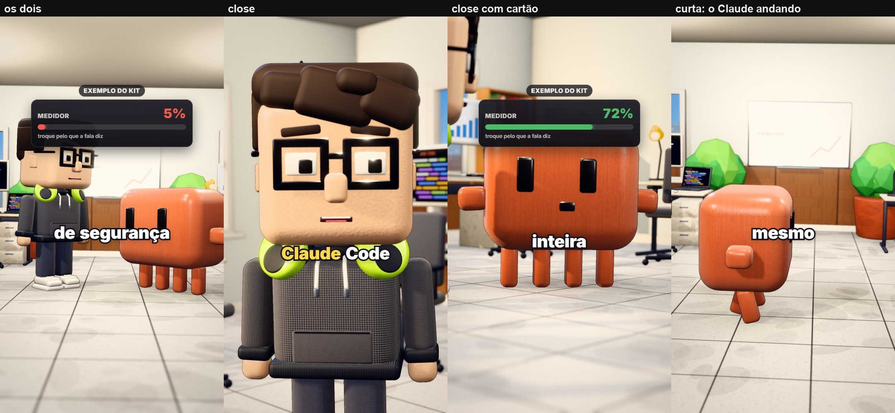
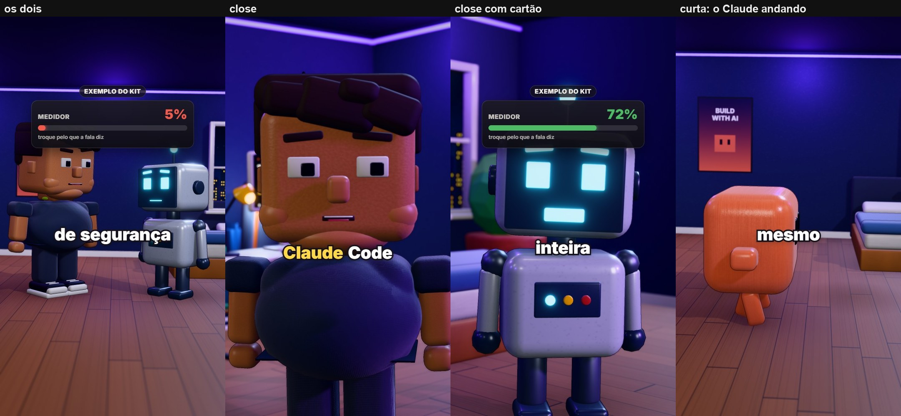
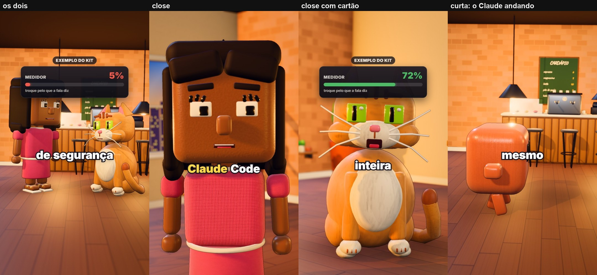
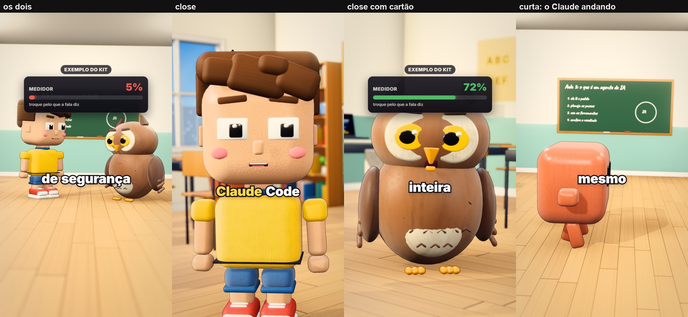
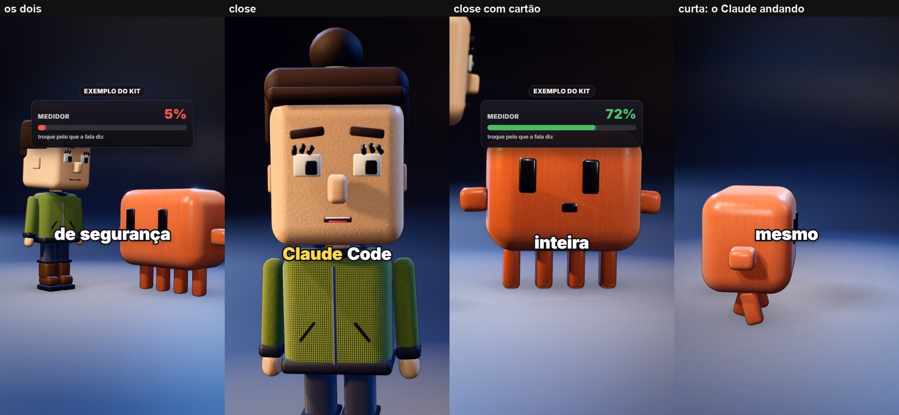

As peças dos cômodos, no kit: `mesa_escritorio`, `cadeira_escritorio`, `cadeira_gamer`, `luminaria_mesa`, `estante_livros`, `quadro_branco` (face `quadro_face`), `lousa` (face `lousa_face`), `lousa_cardapio` (face `lousa_cardapio_face`), `cama`, `prateleira`, `balcao`, `maquina_cafe`, `xicara`, `mesinha`, `cadeira_cafe`, `banqueta`, `carteira` e `janela`. As de parede (o quadro, a lousa, o cardápio, a prateleira, a janela) saem assentadas no chão, como toda peça do kit: ponha a altura na posição (o quadro a 1,0 m, a lousa a 0,9 m, a janela a 0,75 m). As partes servem soltas: `pisoMadeira`, `paisagem(largura, altura, hora)` (a cidade atrás da janela), `cartaz(largura, altura, desenho)` (pôster, quadro de parede, mural), `telaCodigo()` e `telaGrafico` (o que vai no monitor).

**Cenário novo**, quando nenhum serve, segue o que os três têm:

- **um lugar que se reconhece**, com as coisas que existem nele (num depósito, estantes e caixas; numa cozinha, bancada e panelas), em volta das áreas onde a ação acontece e nunca na frente da câmera;
- **o fundo fecha o quadro**: parede, estantes, prédios ou o escuro da neblina; nada de horizonte vazio;
- **luz de cena com a fonte à vista** (a lâmpada, a luminária, a janela), quente contra o frio do recorte, e o resto mais escuro;
- **chão com textura** (`pisoTextura`, com rejunte, manchas e grão), nunca liso;
- **ar**: poeira na luz (`PoeiraNoAr`), neblina que apaga os fundos, um volume de luz (`volumeDeLuz`). Nunca um cone chapado com borda: na folha, ele vira uma fileira de triângulos amarelos no alto de todo quadro;
- um look que combine (o `interior`, o `noite`, o `estudio`, ou um novo em `mundo.ts`).

Monte com as peças do kit e as partes do `cenarios.ts` (`pisoTextura`, `cidade`, `lua`, `cordaoDeLuzes`, `PoeiraNoAr`), e faça no Blender a peça que faltar (ver "Peça nova no Blender"). Um cenário que deu certo vira função no `cenarios.ts`, para o próximo vídeo.

**Na conferência dos quadros, pergunte: o cenário parece acabado e tem cara de lugar?** Se parece um fundo provisório (o gramado vazio, o chão liso, o céu sem nada), ainda não está pronto.

## Na tela

- **Regras de tela do produto:** nada importante a menos de 150 px das laterais nem acima de 220 px. O selo do título fica em 236 px, o contador em 372 px (430 px quando o título tem `sub`, a linha de baixo) e a legenda em uns 1330 px. A câmera deixa o rosto e a ação fora dessas faixas enquanto elas estão na tela.
- **O enquadramento:**
  - os olhos do protagonista ficam entre 700 e 1000 px de altura;
  - os 120 px da direita ficam livres (os botões do Reels);
  - nada nítido sai cortado pela borda; perto da borda, só o que está desfocado em primeiro plano;
  - nada passa por cima do selo do título: o que é alto e fica atrás (uma placa, um prédio) aparece só nos planos em que não cruza o selo.

  Confira com `node scripts/quadros.mjs 1.2,5,9 --guias`, que desenha as faixas em cima do quadro: laterais e topo em vermelho, olhos em verde e selo e legenda em branco.
- **O título do bloco** fica no topo, num selo escuro com o rostinho do Claude. Logo abaixo vem um **contador**, quando há número (TAREFA 57% → 100%), que treme numa batida.
- **A legenda** mostra de 1 a 3 palavras por vez, cada palavra entrando quando é falada. É branca e grossa, com contorno escuro, e as palavras de `destaques` saem na cor de destaque da legenda da pessoa. Cores e fonte vêm do `meu-estilo/marca.json`. Com `"modo": "palavra"`, a legenda mostra uma palavra só, com troca seca.
- **A tela de programa segue a tela de verdade.** Quando o vídeo ensina uma ferramenta, os textos das janelas são os da ferramenta real: copie o comando, a saída e o endereço como aparecem nela (do README, da documentação ou de um print), sem inventar menu nem mensagem. Para a janela por cima da cena, o `Cartao.tsx` tem `JanelaTerminal({ titulo, linhas, digita })` (o terminal, com a linha que se digita) e `JanelaNavegador({ url, children })` (a janela do navegador com a barra de endereço). Na tela de uma peça 3D (o `computador_tela`), desenhe com o `escrever`.
- **O acabamento é fixo** (`src/motor/Palco.tsx`): contorno, sombra de contato, desfoque, brilho, tone map e tratamento de cor, com um granulado bem fraco e um dither no céu, que mudam a cada quadro para o degradê não virar degraus depois da compressão. A cena escolhe o look: `LOOKS.tarde` (o fim de tarde do `/btw`), `LOOKS.dia`, `LOOKS.noite` (o terraço), `LOOKS.interior` (o depósito) ou `LOOKS.estudio`.
- **A luz é pensada para o personagem em cada plano.** Com `luz: "frente"` no que o `posar` devolve (o padrão), a luz principal gira com a câmera e fica de três quartos pela frente do assunto. O laranja do Claude fica laranja, e não tijolo como no contraluz, e a sombra cai para trás. O recorte frio fica sempre atrás. Com `luz: "contra"`, o sol fica onde o look manda: serve para um plano aberto de fim de tarde.
- **Os materiais se diferenciam:** plástico (capacete, cone, placa, baú, amarelo) com verniz; o Claude, a pele e a roupa foscos, com um brilho aveludado na borda (sheen); madeira bem fosca. Branco, papel e nuvem ficam em `#e8e3da` ou abaixo, para não estourar. Peça nova usa `mat(..., coat=0.5)` para plástico e `sheen=0.35` para personagem (`estilo.py`).
- **O chão tem pouco peso:** no mundo ao ar livre, verde menos saturado, manchas grandes de valor, mais escuro longe da ação, tufos em grupos e terra batida onde a ação acontece (`chao({ livres, terra })`). Dentro de um lugar, o piso com textura do cenário.
- **Placa e papel recebem a luz:** o `escrever` numa `_face` e a `placaTexto` pintam só as letras sobre a peça, como tinta, com luz e sombra. A `_tela` acende sozinha.

## Câmera e movimento

Os [princípios de movimento](../referencias/animacoes.md#princípios-de-movimento) e a conferência dos quadros valem aqui como em qualquer estilo. As ferramentas do kit:

- **A câmera tem operador:** um balanço de mão bem leve em todo plano, e o olhar chega um pouco depois da posição nos deslizes. A sacudida dos impactos é ruído suave em três eixos, mais giro que deslocamento, decaindo em 10 quadros.
- **Para personagem, `fov` 42 a 46** com a câmera mais perto: o quadro em pé fica menos estreito e o fundo ganha profundidade.
- **A câmera** (`src/motor/camera.ts`):
  - corte seco (`corte: true`) só nos saltos grandes, de lugar ou de bloco da fala;
  - o resto é deslize de 18 a 40 quadros;
  - **todo plano empurra devagar** (`empurra`, de 0,15 a 0,35 % por quadro): plano parado parece congelado;
  - inclinação de 2 a 4 graus (`roll` de 0,03 a 0,06);
  - sacudida nos impactos (`SACUDIDAS`, de 0,4 a 1);
  - o foco segue o assunto (`FOCOS`): `cInf` 0 nos planos abertos, de 8 a 12 nos médios e de 13 a 16 de perto. Nos cortes, o fundo abre um pouco mais sozinho.
- **Entrada com antecipação, arco e achatar:** `pulo({ de, para, inicio, dur, altura }, peso)` (de `contatos.ts`), declarado no topo do `cena.ts`, devolve a função do quadro. A peça agacha antes de saltar, faz um arco (x e z desaceleram, a altura sobe e desce), estica na descida e achata ao pousar, e o pulo já registra o som da decolagem e do pouso. O `entra()` faz o mesmo sem som e devolve também `decola`, `pouso` e `altura`.
- **No pouso:**
  - `Poeira` (a nuvem);
  - `Lascas` (4 a 8 pedacinhos sólidos que saem em arco e quicam uma vez), só nos pousos pesados;
  - `sombraBolha()`, o disco escuro e macio debaixo de quem pula, que encolhe e clareia com a altura: `bolha.posar(x, z, altura)`.
- **Comprimir e esticar mantém o volume:** no `achata()`, a largura é 1/raiz(altura).
- **As partes presas balançam:** com `pouso`, `susto` ou `sacode` (a parada de uma corrida), o `animarClaude` faz o capacete, o crachá e os braços balançarem e assentarem (`mola()` em `tempo.ts`). Tudo o que estiver pendurado no `claude_corpo` balança sozinho.
- **O piscar é assimétrico:** fecha em 3 quadros e abre em 6. Ele também pisca na virada do olhar: passe em `viradas` os quadros em que o olhar muda de alvo (o piscar na virada é o que faz o olho parecer pensar).
- **Achatar** (`achata(f, toque)`) e **antecipar** (`antecipa(f, inicio)`) servem para o resto: a tampa que bate, o cadeado que cai, o botão.
- **Personagem vivo:** `animarClaude(claude, f, { olhar, aceno, aponta, comemora, susto, tonto, anda, pouso })` e `animarPessoa(...)`. Os dois respiram, piscam e mexem os braços sozinhos. Use `olharPara(claude, ponto)` para o olho seguir o que entra na cena.
  - Cada quadro é calculado do zero: o `tonto` gira os olhos e eles voltam ao lugar sozinhos quando ele acaba (passe o quadro em que começa; passa em uns 4 s).
  - O braço do Claude é um toco. No `aceno`, ele cresce, sobe por cima da cabeça e o corpo balança junto, para o aceno se ver; confira no quadro se o braço aparece.
  - **O achatar soma:** o `pouso` do `animarClaude` já achata o corpo. Se a peça inteira também achata com o `pulo`, os dois se somam e o Claude vira panqueca. O motor limita o corpo a 30% de achatamento; na peça, use só uns 60% do achatar do pulo: `escalar(claude, [lerp(1, e.escala[0], 0.6), lerp(1, e.escala[1], 0.6), lerp(1, e.escala[2], 0.6)])`.
- **Escala real:** porta de 2,1 m, mesa de 0,75 m, pessoa de 1,8 m e o Claude de uns 1 m. Quando algo precisa ser protagonista (um celular, uma lupa), aumente essa peça e só ela, e diga no `movimento.md`.
- **O quadro em pé é estreito:** a 7 m da câmera, com o `fov` 38, cabem só 2,7 m de largura. Um Claude (1 m) e uma prancheta lado a lado pedem uns 8 m de distância; os três modelos no pódio, uns 11 m. No primeiro vídeo, quase todo plano saiu perto demais na primeira tentativa: comece longe e aproxime.
- **Cada lugar da história num canto do mundo, a uns 12 m dos outros.** Câmera de um lugar não pode passar por dentro de outro: no primeiro vídeo, o plano das esteiras atravessou o crachá do lugar do menu, e o quadro ficou todo creme.
- **O que bloqueia a visão sai da frente:** árvore ou peça a menos de 2 m da lente vira borrão cortado na borda. A `natureza` deixa um raio livre e aceita pontos a `evitar`; o `deposito` não põe estante nas áreas `livres` (inclua nelas os lugares por onde a câmera passa).
- **O personagem não fica atrás do que abre:** tampa, porta ou tela que se abre para trás cobre o rosto de quem está atrás. Ponha o personagem ao lado, na diagonal, e confira o quadro com a tampa aberta.
- **Plano aberto mostra o protagonista:** no plano de cima, o Claude não pode virar um ponto. Suba só o necessário para caber a ideia e confira no quadro de tamanho cheio se ele ainda se lê (no vídeo do graphify, ele foi aumentado 1,25 vez e os planos de cima desceram de 19 m para uns 11 m).

## Peça nova no Blender

Use o kit primeiro. Muita coisa sai de uma peça do kit com outra cor (`peca(kit, "pessoa", { cores: { roupa: "#c84b3c" } })`), de duas peças juntas (o computador na mesa) ou das peças do three.js (uma caixa com texto). **Fabrique uma peça nova quando o vídeo pede um objeto que é o assunto da frase** e que não sai disso: o produto que o vídeo mostra, um animal, um veículo, uma máquina da metáfora.

1. O Blender é gratuito (blender.org). Ele só é preciso para peça nova; as do kit já vêm prontas.
2. Copie `blender/peca_nova.py` do projeto, troque o `NOME` e a função `construir`, e rode `node scripts/blender.mjs blender/minha_peca.py`. Leva segundos. A peça sai em `.projetos/NOME/pecas/` e entra no vídeo sozinha; se tiver o nome de uma peça do kit, vale por cima dela.
3. As regras estão no começo do `estilo.py`:
   - metros e escala real;
   - pivô no chão (o `exportar` assenta a peça sozinho e mostra o tamanho);
   - frente para -Y no Blender;
   - cantos chanfrados;
   - materiais da paleta, pelo nome;
   - juntas em "empty" no ponto de giro;
   - telas e placas em nós terminados em `_tela` ou `_face`.

   Monte com caixas, cilindros e esferas chanfrados (`box`, `cyl`, `sphere`, `tube`, `extrude`), como as peças do `pecas.py`.
4. Confira com `node scripts/vitrine.mjs minha_peca`, que gera `out/vitrine/minha_peca.jpg` no acabamento do estilo. Nada de texto modelado com fonte do sistema: o texto vai pelo `escrever`.

Cenas inteiras não são renderizadas no Blender. Com o three.js, a sincronia com cada palavra, a legenda e a câmera ficam no mesmo código, e o render leva segundos em vez de horas.

## Som

Sem música. **Todo contato tem som**: pulo, pouso, passo de corrida, caixa, tampa, mola e batida. Um contato mudo incomoda (o dono, no primeiro vídeo: "quando os Claudezinhos pulam em cima da coisa e não faz nenhum som").

- **O motor põe o som do contato sozinho.** Declare no topo do `cena.ts` (fora do `construir` e do `posar`):
  - `pulo(...)`: decolagem e pouso;
  - `passos((f) => distancia(f), de, ate)`: um toque a cada passo, só nos planos em que quem corre aparece;
  - `batida(f, "leve" | "medio" | "pesado")`;
  - `caixa(f)`, `tampa(f, "abre" | "fecha")` e `mola(f)`.

  Esses sons entram sozinhos com os `EFEITOS` da cena, que ficam só para o que não é contato (o whoosh da câmera, a placa que acende, o contador, a escrita).
- **Todo grave leva uma camada aguda.** O alto-falante do celular perde quase tudo abaixo de 200 a 300 Hz: o "impact-heavy" sozinho vira nada, e o pouso parece mudo. A `batida` já toca o grave e um agudo curto juntos.
- **O tom varia sozinho** de 0,92 a 1,08 a cada vez, para o mesmo som não repetir igual. `tom: 1` fixa.
- **A régua vem da fala medida:**
  - o `preparar.mjs` mede a fala (a mediana das janelas de 100 ms com voz, as mesmas do `escutar`) e o pico de cada efeito;
  - o `Som.tsx` põe o pico do contato uns 9 dB abaixo da fala, o som curto (whoosh, swish, brilho) uns 13 dB abaixo e o contínuo (mais de 0,9 s: escrita, contador, ligar) uns 20 dB abaixo;
  - o `ganho` de cada efeito e o `"efeitos": {"ganho": 0}` do `curta.json` ajustam por cima.
- **Confira com o `escutar`, e no celular, com som.** A coluna "pico-voz" do `escutar` compara com a voz naquele instante. Quando o efeito cai numa pausa, ela dá um número alto que não quer dizer nada: compare com a fala em geral, que o `preparar` mostra em `src/gerado/config.json` (`"voz"`).
- **Som curtíssimo não toca:** no vídeo do graphify, o `click-button-firm` (20 ms) saiu mudo no render (a escuta deu AUSENTE). Use um clique com mais corpo, como o `click-mouse-firm`, e confira na escuta.
- **Arquivos próprios:** os sons que o kit não tem vão em `.projetos/NOME/sons/` e entram como `"sons/arquivo.wav"`, também na régua. Para gerar um, use `python .ferramenta/sistema/editar.py efeito "descrição em inglês" --saida .projetos/NOME/sons/nome.wav`.

## Estilo Conversa

Uma variação do Curta 3D (2026-11-20): **dois personagens conversando**, num cenário com cara de lugar. O padrão é o boneco da pessoa com o Claude, mas os dois lados são escolha de quem faz o vídeo (ver "Quem conversa"). O que muda em relação ao curta comum:

- câmera de plano e contraplano;
- rosto que reage e boca que fala;
- cartões de vidro escuro no alto;
- duas vozes;
- legenda perto do rosto de quem fala.

O roteiro é uma conversa de verdade: cada fala responde à anterior, e a dúvida do público vem na boca do boneco. A numeração ("1 · /clear") fica só nos cartões. Exemplo: o vídeo "O que realmente gasta o limite do Claude Code", do Vitório.

- **Quem conversa (pergunte antes do roteiro).** Os dois lados são escolha da pessoa:
  - o boneco dela com o Claude (o padrão, quando ela não disser);
  - o boneco dela com outro boneco: um cliente, um chefe, um amigo, uma criança;
  - o boneco dela com um bicho ou um objeto que fala: um gato, um robô, uma xícara;
  - dois personagens sem o boneco dela.

  Pergunte numa linha, com o padrão já sugerido ("A conversa é você com o Claude, ou com outro personagem?"). Grave a resposta no roteiro. O exemplo `molde/exemplos/conversa.tsx` troca os dois lados em `A` e `B`, logo no começo.
  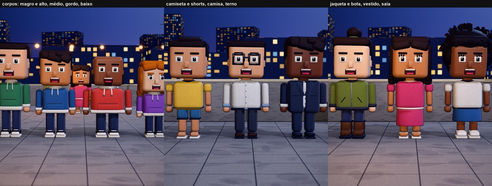
- **Boneco humano novo** sai do `boneco(kit, ficha)`, sem Blender. Com a ficha dá para fazer pessoas bem diferentes (a imagem acima):
  - cabelo: `"padrao"`, `"curto"`, `"topete"`, `"longo"` (risca no meio, até o ombro), `"coque"`, `"cacheado"` (volumoso, com a calota, a nuca, as laterais e uns 70 cachos em mola por cima, e os cachinhos da franja na testa) ou `"careca"`, na `corCabelo` (grisalho é `#d8d4cc`; a sobrancelha, a barba e o bigode usam a mesma cor);
  - pele em qualquer tom (`pele`), `cilios`, `barba`, `bigode`, `oculos` (e `corOculos`), `bone`, `fone`;
  - **o corpo:** `corpo: "magro" | "medio" | "gordo"` escolhe a peça (`boneco_magro`, `boneco`, `boneco_gordo`), com os mesmos nós e opções.
    - O **magro** tem tronco e ombros estreitos, braços e pernas finos e o rosto mais fino.
    - O **gordo** tem a barriga redonda que avança na frente e dos lados, tronco mais curto e largo, pescoço, braços e pernas grossos e o rosto cheio, com bochecha, queixo redondo e papada leve.
    - A roupa acompanha: a barriga é fundida no corpo de cada roupa (sem a emenda de uma bola encostada), e os botões da camisa, o zíper da jaqueta e o bolso do moletom seguem a curva dela.
    - `altura` vai de 0,85 a 1,15 (1 é a pessoa média) e escala tudo.
    - Com a câmera andando devagar, o tecido da barriga deu 2,5 de tremido, igual ao do moletom médio (2,2).
    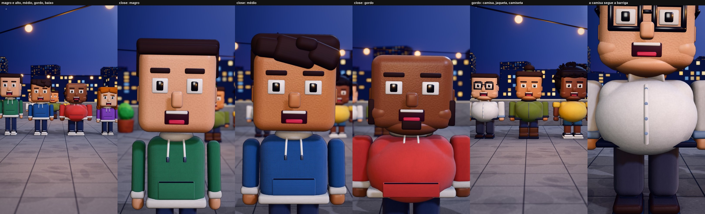
  - **a roupa de cima:** `cima: "moletom"` (o padrão), `"camiseta"` (manga curta, gola redonda), `"camisa"` (social: colarinho, botões e cinto), `"blazer"` (terno: as duas frentes com lapela e a camisa no V), `"jaqueta"` (gola em pé, zíper, bolsos, ribana) ou `"vestido"` (corpo e saia rodada numa peça, com faixa);
  - **a de baixo:** `baixo: "calca"` (o padrão), `"shorts"` (com a perna à mostra) ou `"saia"`; com o vestido, não conta;
  - **o calçado:** `calcado: "tenis"` (o padrão), `"social"` (com salto e fivela), `"bota"` (cano até a canela) ou `"sandalia"` (o pé à mostra);
  - as cores de tudo isso pela `roupa`, `detalheRoupa` (a gola, os punhos, a camisa do terno, os botões), `calca` (a calça, o shorts e a saia) e `sapato`, e o que vai bordado no peito (`peito`, no moletom, na camiseta e na jaqueta). O tecido usa a textura assada do kit (a que não tremula de longe);
  - `idade: "crianca"`: a peça `boneco_crianca`, com proporção de criança (cabeça grande, rosto redondo, olhos grandes com brilho, nariz e boca pequenos, bochecha, membros curtos) e as mesmas roupas.

  **A régua acompanha a ficha:** o ator de todo boneco é `ator(rostoDoBoneco(ficha), posicao, rotacao)`. Ele dá a altura dos olhos e da boca da criança e da `altura`, e abre o close para o cabelo volumoso caber (o cacheado e o coque).

  Personagem fixo (o do perfil) precisa de uma marca que mude a silhueta (o fone, o boné); o convidado, não.
- **Personagem que não é humano** (um gato, um robô, uma xícara) é uma peça nova no Blender (ver "Peça nova no Blender"), com o **contrato do rosto**, para o `dialogo()`, a régua e o `conferir.mjs` funcionarem com ele como com os outros:
  - **os nós do rosto**, com o nome da peça na frente: `NOME_boca` (o pivô no meio da boca; a escala na altura é a abertura da sílaba), `NOME_olhoE` e `NOME_olhoD` (a escala na altura pisca e muda com a emoção). Opcionais: `NOME_sobrancelhaE/D` (sobe e gira com a emoção), `NOME_pupilaE/D` (segue o olhar), `NOME_cabeca` (o pivô no pescoço: acena ao falar) e `NOME_bracoE/D` (o braço, a pata ou a asa, com o pivô no ombro: balança, gesticula um pouco ao falar, dá de ombros, aponta, abre as mãos e acena, com os mesmos `ombros`, `aponta`, `maos` e `aceno` do boneco) e `NOME_dedoD` (o dedo, a ponta fina, o dedinho da pata ou a pena da asa, no braço direito: o kit esconde e mostra só no `aponta`; deixe acima do chão, senão a peça sobe ao ser assentada);
  - **as alturas**, medidas no Blender e registradas na cena: `registrarRosto("gato", { olhos, boca, face, meioOlho, tamanho })`. São os olhos e a boca (m, do chão), quanto a cara fica à frente do centro da peça, metade da altura do olho e o `tamanho` do close (a largura da cabeça mais uns 25%: a cabeça de 0,6 m usa 0,74). Isso entra no `ROSTO` e na régua;
  - **na cena**: `peca(kit, "gato")`, `ator("gato", posicao, rotacao)` no `dialogo()` e `animarRosto(gato, "gato", f, { quem, emocoes, olhar, viradas, semente })` no `posar`. Ponha a peça na lista `pecas` do `curta.json`;
  - **a receita**: rosto grande e de frente (os olhos e a boca na mesma face, virada para -Y no Blender), olhos e boca em cor que contrasta com a cara (no robô, ciano aceso na tela escura), sobrancelha logo acima do olho, dentro da cara (fora dela, some na borda), e o resto do corpo simples. Confira com `vitrine.mjs` e com quadros soltos de um close: a boca abrindo numa sílaba, um piscar, uma emoção e o `conferir.mjs` passando na régua.

  - **o pelo e a pena** usam o tipo `pelo` do kit (materiais `pelo*` e `pena*`): tufos curtos e largos, de pouco contraste, todos para o mesmo lado. Pelo fino de verdade fica menor que um pixel no plano aberto e tremula; medido com a câmera andando, o pelo do gato deu 3,2 de tremido (o limite é 4,0), só nas bordas, que é o movimento. Bigode é tubo de 6,5 mm, não fio: mais fino, ele serrilha.

  Prontos no kit, para usar ou para copiar a receita: `gato`, `coruja` e `robo` (`{ tipo: "gato" }` no `B` do exemplo de conversa). Todos falam, piscam, mudam com a emoção, gesticulam e passam na régua (a coruja no lugar do Claude, conferida pelo `conferir.mjs`).
  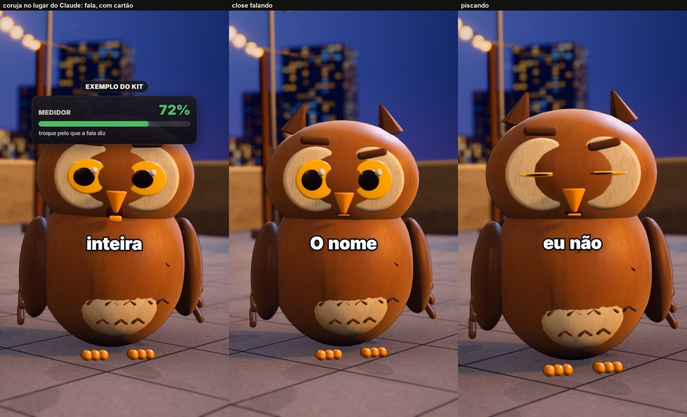
  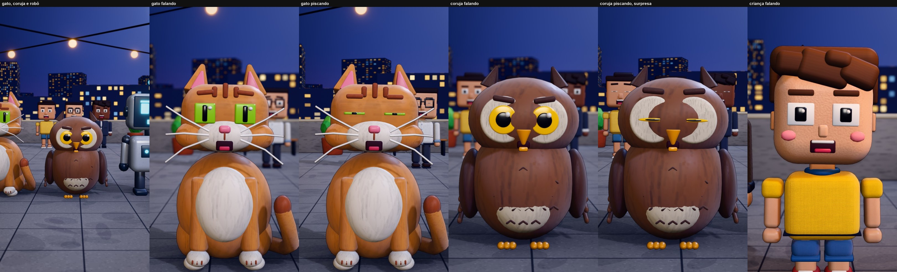
  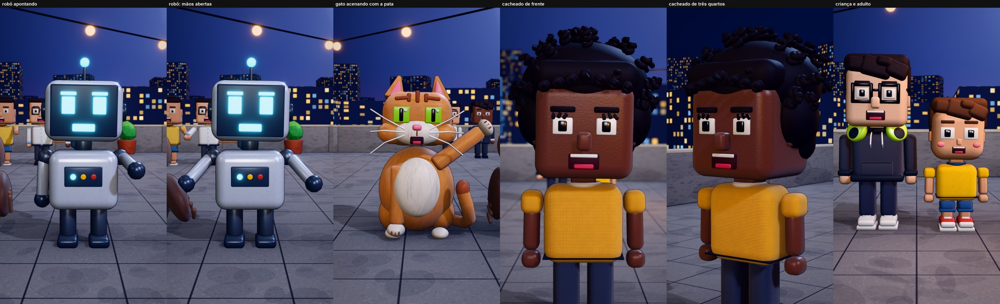
  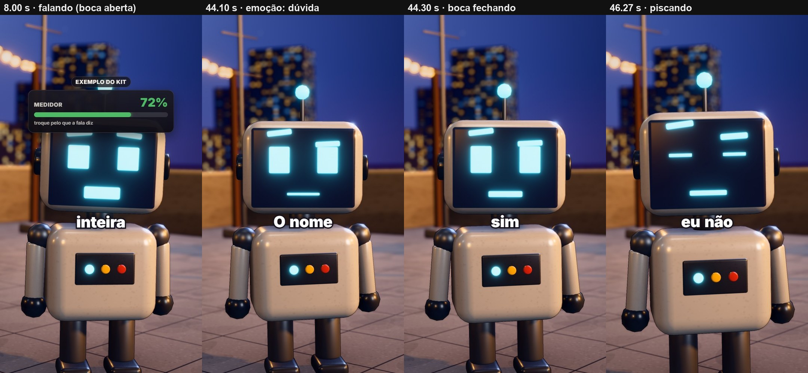
- **As vozes:** cada fala numa linha, com `[nome]` no começo, e `[pausa 0.5]` onde a conversa respira. O `"vozes"` do `meu-estilo/marca.json` leva uma voz para cada nome (`[claude]`, `[gato]`, `[cliente]`): para o Claude, uma voz calma e um pouco mais aguda que a da pessoa; para um personagem novo, escolha uma voz no catálogo da ElevenLabs (ver [voz-de-ia.md](../referencias/voz-de-ia.md)) e **teste com uma frase curta dele antes de gerar a conversa inteira**: a voz de um gato, de um robô ou de uma criança que não convence estraga o vídeo todo. A palavra da tela (`/clear`, `CLAUDE.md`) vai no texto como aparece; o jeito de falar ("barra clír") vai no `pronuncia.md`, ao lado do texto. Depois de gerar, transcreva as falas com comandos para conferir. **Com a voz da pessoa** (ou de quem ela chamar para o outro personagem), o mesmo texto marcado vai para `python .ferramenta/sistema/editar.py falas-gravadas .projetos/NOME/texto.txt AUDIOS... --saida .projetos/NOME/corte`: um áudio só com as duas vozes, lido na ordem do texto (quem fala sai da ordem das falas); um áudio por personagem, com o nome dele no arquivo (`eu.m4a`, `claude.m4a`, iguais aos nomes entre colchetes); ou um por fala, na ordem (o mais seguro numa conversa longa). Sai o mesmo `palavras.json`, com `quem` e `fala`, e as duas vozes no mesmo volume. O `palavras.json` sai com `quem` e `fala` em cada palavra, e o motor usa isso para a boca, para a câmera e para a legenda.
- **O boneco da pessoa:**
  - é a peça `boneco`, de blocos, com rosto que fala, montada por uma ficha (`motor/rosto.ts`): `boneco(kit, { pele, cabelo: "padrao" | "curto" | "topete" | "longo" | "coque" | "cacheado" | "careca", corCabelo, cilios, idade, oculos, corOculos, barba, bigode, bone, corBone, fone, corFone, peito, corPeito, roupa, detalheRoupa, calca, sapato })`;
  - **todo personagem fixo precisa de uma marca que mude a silhueta**, como o boné da referência: um acessório grande (o `fone` no pescoço, o `bone`) na cor da marca, e algo escrito ou bordado no peito (`peito: "IA"`);
  - a ficha da pessoa fica no `cena.tsx` do projeto (ou em `meu-estilo/`, para usar sempre);
  - a do Vitório é `FICHA_VITORIO`: óculos de armação preta grossa, cabelo `"padrao"` (o curto com franja penteada para o lado), fone grande verde-limão (`#c8f560`) no pescoço e moletom grafite com "IA" bordado em verde-limão.
- **O Claude que fala:** é a peça `claude_rosto`, o Claude com boca, olhos felizes ("^ ^") e bochecha corada.
- **O Claude laranja à noite:** a luz principal da noite é a lua, fria, e laranja sob luz azul vira vinho escuro. O `LOOKS.noite` dá ao Claude um pouco da própria cor (`claudeProprio: 0.26`, em `mundo.ts`), e ele segura o laranja da marca em todo plano. Look novo para a noite leva o mesmo campo.
- **O volume do Claude** (vale para todo Claude do kit), para ele não parecer um bloco de plástico chapado:
  - bisel largo e redondo (0,17 m), que pega a luz na quina;
  - a cor um pouco mais clara no alto e mais escura na base, como a luz do céu e o chão;
  - material de verdade, assado no Blender (`pecas/blender/texturas.py`, que grava a cor, a aspereza e o relevo em `pecas/texturas/`): metal escovado, com riscos finos na horizontal, manchas largas e o brilho quebrando onde a aspereza muda. O moletom e a calça usam o tecido assado (trama e fiapos) e a pele, a pele assada (poros e manchinhas). O `preparar.mjs` leva as texturas e o `kit.ts` põe cada uma pelo nome do material; sem elas, o kit cai na textura desenhada no canvas;
  - olhos envernizados, que pegam um brilho;
  - o recorte frio por trás, mais forte no close (`mundo.ts`);
  - a sombra de contato do N8AO e do sol no chão.
- **O apontar se lê de frente** (o boneco e todo personagem com braço, pata ou asa): o braço direito (o do lado direito do quadro) sai na diagonal, para a frente e para o lado do que ele aponta; o dedo aparece; a cabeça e o corpo viram um pouco para lá e os olhos vão junto. Antes, o braço ia reto para a lente e, de frente, parecia só subir para o lado. Aponte para o lado em que está a coisa (o cartão, o outro personagem); se ela está do outro lado, gire o personagem na cena.
  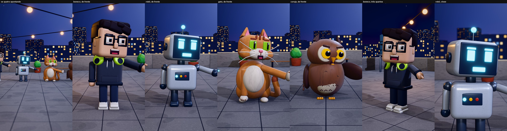
- **O rosto** (`motor/rosto.ts`):
  - `animarBoneco(b, f, { quem, emocoes, olhar, viradas, ombros })`: a boca abre em cada sílaba da fala de `quem`, mais nas vogais abertas, e estreita no "o" e no "u" (`motor/fala.ts`);
  - a sobrancelha segue a emoção (`neutro`, `bravo`, `surpreso`, `duvida`, `sem_graca`, `feliz`, `pensando`), passando de uma para outra em 6 quadros;
  - pisca na virada do olhar, dá de ombros (`ombros`), aponta (`aponta: [de, ate]`) e abre as duas mãos (`maos: [de, ate]`). Ponha um ou dois gestos de mão por vídeo, nas perguntas e nas objeções;
  - `animarClaudeFala(c, f, { olhos: [[quadro, "feliz"]], bochecha: [[de, ate]] })`.
  - **A emoção está no rosto, não nos braços.**
- **Os atores:** `ator("boneco" | "claude" | "robo" | o nome registrado, posicao, rotacaoY)` (em `dialogo.ts`; para a criança, `ator(rostoDoBoneco(ficha), ...)`) devolve o rosto, a frente, o tamanho do close e a altura dos olhos e da boca, que vêm de duas constantes exportadas:
  - `ROSTO`: os olhos e a boca de cada peça, do chão. O boneco tem os olhos a 1,36 m e a boca a 1,15 m. O Claude (e o `claude_rosto`) tem os olhos a 0,75 m e a boca a 0,56 m;
  - personagem novo entra no `ROSTO` com `registrarRosto` (ver "Personagem que não é humano");
  - `TAMANHO`: o tamanho que enquadra o close sem cortar. O boneco usa 0,74 (com 0,6, a cabeça saía cortada) e o Claude 1,15 (com 0,8, o close cortava os dois lados).
- **A câmera de diálogo** (`motor/dialogo.ts`): `dialogo({ [pessoa]: ator("boneco", ...), claude: ator("claude", ...) }, { cartao, cartaoBase })` monta tudo a partir das falas:
  - o close de quem fala, de frente e um pouco para o lado de quem escuta (o olhar fica perto da lente);
  - o plano médio e o plano dos dois juntos nas falas longas e a cada três trocas;
  - um corte a cada 2,5 a 3,5 s, 2 quadros antes de cada fala;
  - o desfoque forte no close, com o rosto enchendo a tela mesmo com cartão no alto (o cartão pode encostar no alto da cabeça);
  - a luz de cada plano (`luzEm`): no close, a principal quente bem de lado (`luz: "lado"`), com o outro lado do rosto na sombra, como o sol da referência; nos outros planos, de frente;
  - **a régua, em todo quadro:** os olhos de quem fala entre 700 e 1000 px; com cartão no alto, o alto dos olhos 40 px abaixo da base dele (o cartão pode cobrir o cabelo, os olhos nunca; os olhos do Claude têm 22 cm de altura, e a régua conta o olho inteiro); a boca acima da legenda, e a legenda acima de 1560 px. Quando as duas regras brigam (um cartão que desce demais: com o Claude em close, além de uns 860 px), o cartão vence e o `conferir.mjs` reprova os olhos fora da régua: diminua o cartão (o `base` dele menor faz o conteúdo encolher);
  - o empurrão tem limite: numa fala longa, o close chega no máximo 14% mais perto (o médio, 10%; o dos dois, 7%). Antes, numa fala de 14 s, o close empurrava até os olhos descerem a uns 1150 px, com a legenda em cima da boca;
  - a altura da legenda, que fica 75 px abaixo da boca de quem fala, projetada pela câmera (`LEGENDA_Y`);
  - `medir(f)`: o que a régua mede em cada quadro. Exporte `REGUA = D.medir` na cena: o `conferir.mjs` lê e reprova o trecho que sair dela.

  Com `somDoCorte`, cada corte ganha o seu whoosh baixo.
- **Os cartões** (`motor/Cartao.tsx`, exportados como `CARTOES` no `cena.tsx`): vidro escuro de 330 px para baixo, com o selinho do título e os tracinhos dos passos. Os conteúdos prontos são `Medidor`, `Pilha`, `Terminal`, `Grade`, `Arquivo`, `JanelaTerminal` e `JanelaNavegador`; o resto é JSX do projeto. Cada cartão entra na palavra que o nomeia e mostra ao pé da letra o que a fala diz, com `somDoCartao` (o deslocamento de ar e o estalo).
  - **O conteúdo entra junto com o título.** Cartão com o vidro vazio, esperando a palavra seguinte, parece quebrado (no ECC, o cartão ficou 1,2 s vazio). O primeiro elemento entra com o cartão; os outros, nas palavras deles. O `conferir.mjs` reprova o cartão ainda vazio 0,4 s depois de entrar.
  - **Nada passa da borda do vidro.** O `Cartao.tsx` mede o conteúdo a cada quadro e o encolhe até caber na largura e acima da base máxima (900 px). No ECC, a grade dos 328 pontos passava do vidro e cinco fileiras ficavam por cima do Claude. O `conferir.mjs` também reprova o conteúdo que fica fora do vidro.
  - **O vidro é quase opaco** (94 a 96%): sobre o terraço, com o cordão de lâmpadas atrás, o vidro meio transparente deixava os fios se lerem através dele. A entrada e a saída têm 3 quadros de opacidade, para nenhum quadro pegar o cartão meio apagado, como um fantasma.
  - **A base é medida, não chutada.** O `conferir.mjs` renderiza só os cartões, mede onde cada um termina e grava em `out/bases.json`; o próximo render desce os rostos por essa base, só o necessário. A `base` à mão (ou o padrão de 900) vale enquanto não houver medida. Rode o conferir antes do primeiro render e depois dele.
  - **Comando inteiro, nunca cortado:** a `JanelaTerminal` encolhe a fonte até a linha mais comprida caber inteira (de 32 a 20 px), contada já completa, para não mudar de tamanho enquanto digita. Abaixo de 20 px, a linha quebra.
  - **Símbolo desenhado:** ★, ✕, ✓ e emoji caem na fonte do sistema e saem diferentes em cada máquina. Use `Estrela`, `Xis` e `Certo` do `Cartao.tsx`. O `conferir.mjs` reprova o caractere no código da cena.
- **O cenário:** `terraco(kit)` (`motor/cenarios.ts`) é o terraço de um prédio à noite, com `LOOKS.noite`. Ele traz:
  - piso de cimento com rejunte e textura;
  - mureta, caixa d'água, antena, condensadoras, vasos e banco;
  - um cordão de lâmpadas quentes, com luz de verdade;
  - a cidade acesa embaixo e uma lua enorme.

  Para outro lugar, junte as partes (`pisoTextura`, `cidade`, `lua`, `cordaoDeLuzes`) e peças do kit, e mantenha a regra: fundo escuro, luz de cena e chão com textura, nunca o campo liso. Ponha a lua (ou o que brilha) atrás de quem aparece mais nos closes.
- **Contorno discreto:** `contorno: CONTORNO_DISCRETO` na cena (`Palco.tsx`) deixa o traço fino, de espessura quase constante e só na silhueta, sem as linhas de dobra por dentro do corpo. A referência quase não tem contorno: o volume vem da luz e do material. `contorno: false` tira o traço. À noite, use `vinheta: 0.12`, para a borda do quadro não virar uma faixa preta.
- **O boneco acabado:**
  - cantos arredondados em tudo;
  - moletom com barra e punhos de ribana, bolso canguru com costura, gola e cordão do capuz;
  - tênis com sola, biqueira e cadarço;
  - fone com arco, almofada, hastes e conchas com almofada redonda;
  - a pele e o tecido assados;
  - `sombraContato()` debaixo de quem está no chão.
- **Textura que não tremula de longe:** a textura fina (a trama do tecido, os riscos do Claude, os fios do cabelo) fica menor que um pixel no plano aberto e pisca em movimento, mesmo quando o quadro parado parece bom. A regra do kit:
  - todas as texturas com mipmap e anisotropia no máximo;
  - a trama larga e de pouco contraste (no Blender, `texturas.py`);
  - o relevo (normal map) perdendo força com a distância da câmera (`FADE` no `kit.ts`: o tecido de 2,6 a 5 m, o Claude de 3,2 a 6,5 m).

  De perto, a trama aparece; de longe, fica só a cor. Para conferir, use 10 a 15 quadros seguidos de um plano aberto, e não um quadro só: meça a diferença média entre eles na região da roupa.
  - À noite, o granulado do tratamento de cor fica fraco e parado entre os quadros (`granulado: { forca: 0.005, fixo: true }` na cena): o grão que muda a cada quadro, sobre muita área escura, também vira tremido.
- **O cabelo:** `cabelo: "padrao"` é o curto com acabamento: massas grandes e suaves (calota, nuca, laterais), uma franja de quatro mechas de tamanhos, alturas e ângulos diferentes, uma por cima da outra e penteadas para o lado, e a risca. O material é quase liso e fosco (aspereza 0,7, pouco reflexo): o volume vem do brilho largo e suave e de cada mecha ter a base mais escura e a ponta mais clara, e não de ranhuras (com relevo forte, o cabelo parecia plástico canelado; brilhante demais, parecia plástico). As outras opções (`curto`, `topete`, `longo`, `careca`) continuam.
- **Escrita em cima de peça sem piscar:** o desenho do `escrever` fica 3 mm à frente, com `polygonOffset`, e a câmera tem o plano de perto em 0,2 m (com 0,05 m, a profundidade não tinha precisão e o "IA" do peito piscava). A placa onde o bordado fica é invisível: sobra só o bordado.
- **Textura:** o kit põe sozinho uma textura sutil em cada material, pelo nome: poros na pele, trama no tecido, grão, riscos e as bordas um pouco gastas no plástico, veio na madeira e grão no concreto. É a maior diferença para o plástico liso no close. Para desligar: `carregarKit(nomes, { textura: false })`.
- **O cartão nunca tapa um rosto:**
  - o cartão começa em 330 px, fica a 150 px das laterais (os 120 px da direita são dos botões do Reels) e a base não passa de 900 px (o conteúdo encolhe até caber);
  - com cartão no alto, a régua do `dialogo` desce o rosto de quem fala até o alto dos olhos ficar 40 px abaixo da base medida. Pode cobrir o alto da cabeça e o cabelo, os olhos nunca;
  - o limite de baixo é a área segura: a legenda acima de 1560 px, e a boca acima da legenda;
  - `baseDoCartao(CARTOES)` vai no `cartaoBase` do `dialogo` (ele lê a base medida);
  - o `conferir.mjs` reprova o que sair da régua; para ver, `quadros.mjs --guias`;
  - o Claude cortado na borda do plano dos dois pode: dá imersão.
- **Cartões legíveis no celular:** poucos elementos, grandes, com texto curto (36 px ou mais) e um número ou uma frase de resumo embaixo.
- **O fim:** o close de quem pede ("Salva esse vídeo") olhando para a lente e, quando o objeto do pedido cai (o marcador), a câmera abre e ele cai do lado de quem fala, sem cobrir ninguém.
- **Som:** sem música. Cada corte, cada cartão e cada contato tem som, na régua automática. Entre as falas, silêncio.

## Erros comuns

- **"palavra não encontrada na fala":** o `q("...")` usa uma palavra que não está em `src/gerado/palavras.json`, ou a n-ésima vez não existe.
- **"efeito sem preparar":** o id não existe no catálogo. Os scripts rodam o `preparar.mjs` sozinhos; para conferir à mão, rode `node scripts/preparar.mjs`.
- **Tela preta ou tudo sem acabamento:** o navegador não conseguiu usar a placa de vídeo. Rode de novo com `CURTA_GL=swangle` antes do comando: é mais lento, mas roda só no processador. Ainda não foi testado.
- **A pasta `.tmp` do projeto cresce:** é a montagem do Remotion, que os scripts apagam no fim. Se um render parar no meio, apague a pasta.

## Licença do Remotion

O Remotion é gratuito para pessoa física e para empresa de até 3 funcionários. **Empresa maior precisa comprar a licença do Remotion** (remotion.pro). O three.js, o Blender e os pacotes de acabamento são livres. O código de acabamento (contorno, desfoque, tratamento de cor e câmera) vem da skill cartoon-3d-short, sob a licença MIT (© 2026 Mr omi), e o aviso dela está em `.ferramenta/skill/referencias/curta3d/LICENCA-cartoon-3d-short.txt`.
