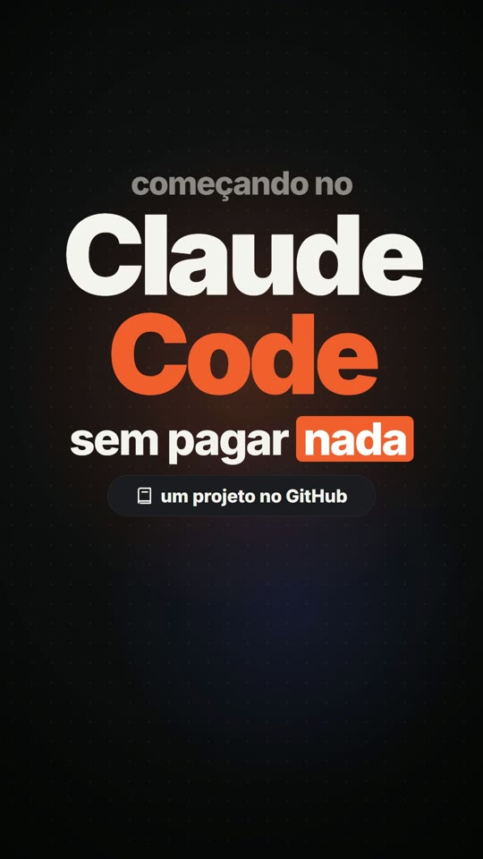
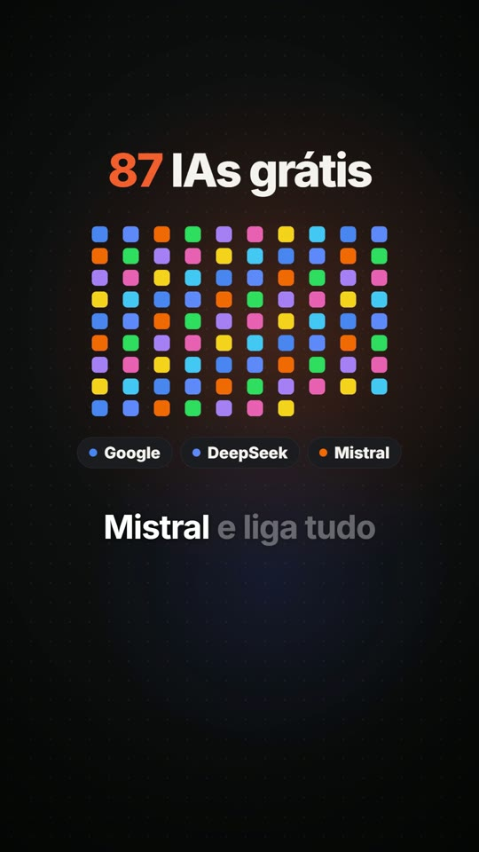
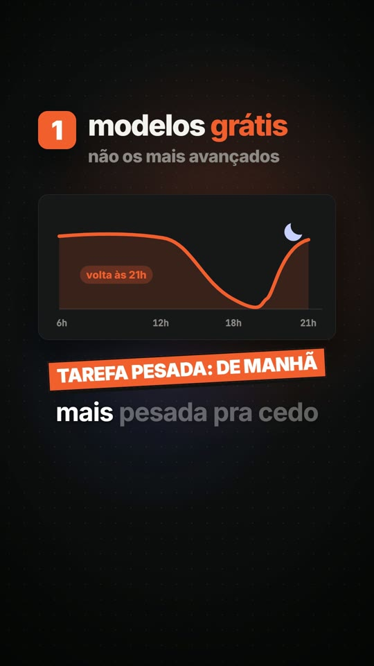
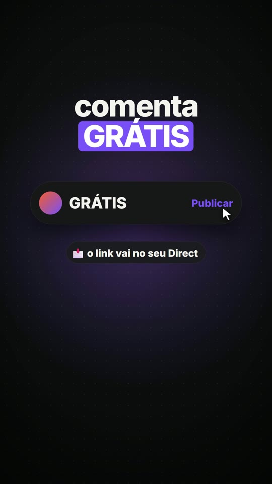

# Estilo Motion

Vídeo feito só de animação, sem a pessoa em cena: só a voz, gravada por ela ou gerada por IA. Uma cena por frase, em tela cheia, com o texto entrando palavra por palavra no tempo da fala. Bom para quem não quer aparecer, para perfis sem rosto, para explicar ferramenta e para anúncio.

Fundo grafite quase preto, brilho que passeia, interface escura e a cor `motion` da marca como acento. As cenas se emendam: cada uma nasce de um elemento da anterior.

   

## A voz

- **Gravada pela pessoa:** o áudio do celular (o gravador de voz serve; m4a, mp3 ou wav), posto em `editor/brutos/`. Ele passa pelo `transcrever` e pelo `cortar`, como um vídeo: saem as pausas, entra o tratamento de voz, e o vídeo de base é preto, com a duração exata da voz. O tempo de cada palavra é o da gravação.
- **Voz de IA (opcional):** ElevenLabs, com a conta e a chave da própria pessoa. O passo a passo inteiro (conta, plano, chave, escolher a voz, gerar, pronúncia e os erros comuns) está em [voz-de-ia.md](../referencias/voz-de-ia.md). Custa créditos da ElevenLabs: avise antes.

## Na tela

- **Fundo único para o vídeo inteiro**, com uma textura que anda devagar e um brilho que passeia: `"arquivo": "mo-fundo.html"`, direto das referências, do início ao fim, com `"marcas"` no começo do pedido final, quando entra a cor `motion_fim`.
- **Uma coisa importante por vez.** Nada fixo na tela o vídeo inteiro: um terminal, um painel ou um medidor que fica do começo ao fim carrega a tela e disputa com a cena. O que pode ficar, se o roteiro pedir, é pequeno e discreto: as abas dos capítulos no alto (`mo-abas`), quando o vídeo tem partes claras, ou um mascote simples (desenhado em SVG para a marca da pessoa) que reage ao que acontece ("uau", "pronto!").
- **Uma cena por frase**, em tela cheia (`bloco` com `x` 0, `y` 0, `largura` 1080 e `legenda_fica`).
- **As cenas se emendam**, em vez de cada uma subir e sumir: a cena termina com um elemento parado (`sai("#$IDc", ".o-que-fica")`) e a seguinte começa com uma cópia dele no mesmo lugar e o transforma (`vira()`). A pílula vira a janela, a janela encolhe até virar o primeiro quadradinho de uma grade, o cartão vira o selo do título, o número do selo rola de 1 para 2. Varie a emenda ao longo do vídeo. Como fazer está em "Princípios de movimento", no [guia de animação](../referencias/animacoes.md).
- **Texto:** sem serifa bem grossa, claro, entrando palavra por palavra no tempo da fala e saindo de um desfoque, com as palavras de ligação mais apagadas. Palavra-chave na cor `motion` da marca ou num selo dela; palavra de efeito em serifada itálica.
- **Contraste de tamanho, cena a cena:** o que faz o Motion prender é a palavra que importa ficar **gigante** (`mo-gigante`, 180 a 260 px) e o resto da frase pequeno em volta: "CRM" enorme com "100% funcional" embaixo, o QR code ocupando a tela, o "comenta CRM" no fim. Título pequeno no alto em toda cena, com a animação embaixo, deixa o vídeo uniforme e sem impacto. Varie: uma cena com palavra gigante, outra com a interface grande, outra com a frase no centro.
- **Título em no máximo 3 linhas.** Frase longa: quebre em duas cenas, ou deixe só a parte forte grande e o resto pequeno.
- **Cursor sem nome**, que clica, arrasta e digita (a marcação da seta está no começo do `mo-base.css`; o movimento, na função `cursor` do `mo-base.js`).
- **Interface de mentira, bem feita:** janelas escuras com os três pontinhos, terminal, celular com a conversa, tabela, cartões. Se o vídeo ensina uma ferramenta de verdade, a tela segue a de verdade.
- **Janela com texto fica parada** depois de entrar: o que se mexe é o conteúdo (digitação, barra, cartão). Janela flutuando faz o texto miúdo tremer.
- **Número que conta:** prazo, preço, quantidade e porcentagem entram contando (`conta()`, com o milhar do Brasil) num cartão grande (`mo-quadro`) ou no próprio título; barra enchendo (`mo-trilho` e `barra()`); nome ou número que troca rolando (`troca()`); comparação lado a lado ("com isso: 1 min" e "sozinho: 3 semanas").
- **Mostrar com coisas, não só com texto**, quando o roteiro pedir: uma multidão de bonecos (`multidao()`) para "100 clientes" ou "1 em cada 10", colorindo os que importam; um recibo (`mo-recibo`) para custo; uma etiqueta colada e inclinada (`mo-etiqueta`) para o rótulo forte ("GRÁTIS", "100 clientes falsos"); um carimbo de aprovado e reprovado.
- **Movimento com peso:** o que bate na tela (selo, etiqueta, ícone) achata e volta (`impacto()`); o que muda de lugar recua antes e vai em arco (`vai()`); as partes de um conjunto chegam depois do recipiente (`conjunto()`); grande mais devagar, detalhe mais rápido. A tabela de tempos está no guia de animação.
- **Nada parado:** a cena sempre tem algo se mexendo (contador, barra, digitação, cursor, fundo).
- **Legenda:** a legenda karaokê embaixo da cena ajuda a acompanhar: a frase aparece apagada e cada palavra acende quando é falada (`"legenda": {"modo": "karaoke", "classe": "leg-forte", "y": 1150, "caracteres": 22, "destaques": [...]}`). Deixe as cenas acima de uns 1100 px. Onde a cena já escreve a mesma frase em grande, esconda a legenda nesse trecho (um `bloco` vazio com `esconde_legenda`), e no gancho também.
- **Área segura:** conteúdo entre y 230 e 1500 e entre x 90 e 990.

## Som

Um efeito em cada ação: clique quando algo é acionado, teclado na digitação, notificação nas mensagens, contagem num número subindo, sino quando algo fica pronto. Com voz de IA, que vem mais baixa, os efeitos descem: `"efeitos": {"ganho": -6}`.

## Como montar

1. A voz: `voz projetos/NOME/texto.txt --saida projetos/NOME/corte` (IA) ou, com a gravação da pessoa, `transcrever editor/brutos/AUDIO.m4a --saida projetos/NOME/fala` e `cortar editor/brutos/AUDIO.m4a projetos/NOME/fala/palavras.json --saida projetos/NOME/corte` (um áudio sem vídeo vira vídeo preto com a voz).
2. O fundo (`mo-fundo.html`) primeiro, do início ao fim; depois uma cena por frase, com `"marcas"` em cada palavra que entra (`python sistema/editar.py palavras PALAVRAS.json DE ATE` dá as referências prontas). No `<style>` de cada cena, `<!--#inclui mo-base.css-->`; no `<script>`, `<!--#inclui mo-base.js-->` (palavra por palavra, cursor, digitação, entrada, emenda, impacto, saída). A última cena pode ficar até meio segundo depois da última palavra.
3. `montar`, olhar os quadros, `renderizar`, `escutar`, `finalizar`.
