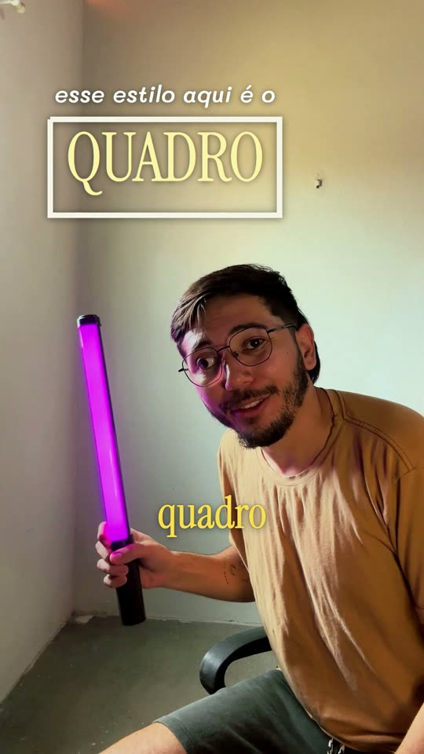
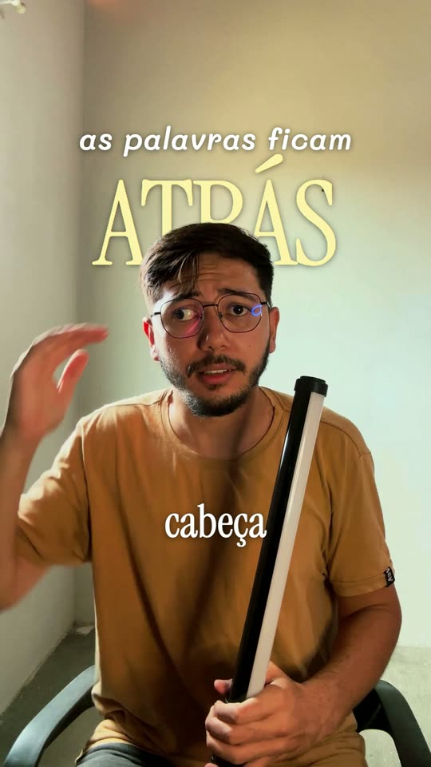
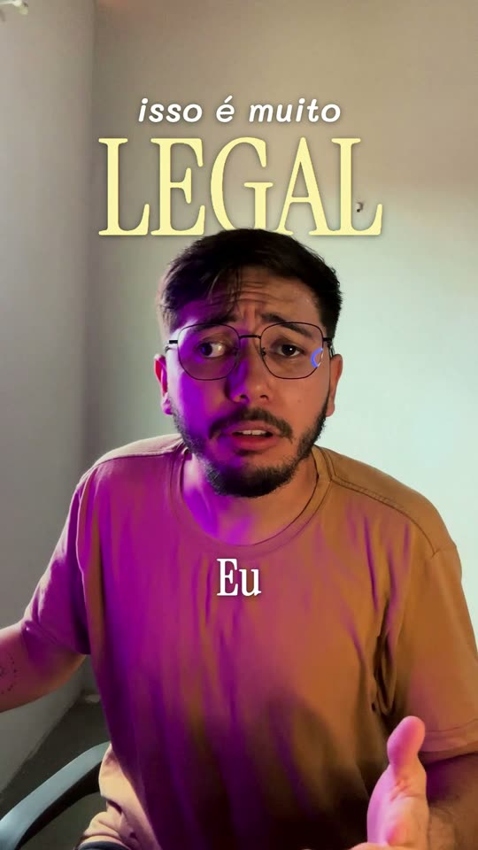

# Estilo Parede

A parede lisa atrás da pessoa vira um pôster: palavras gigantes ficam **atrás da cabeça dela**, como se estivessem pintadas na parede. Ela fica na frente porque o vídeo é recortado quadro a quadro. Bom para vídeo de opinião, falando para a câmera.

  

## Gravação

- Parede lisa atrás, sem quadro nem prateleira, e **espaço livre acima e ao lado da cabeça**: é ali que as palavras moram.
- Câmera parada, na altura dos olhos, vídeo em pé.
- Se a gravação veio com pouco espaço, o ajuste vale só para ela. A regra do estilo segue o jeito certo de gravar.

## Na tela

| Elemento | Como é |
|---|---|
| Palavra-chave | Gigante (230 a 330 px), serifada, na cor de destaque da marca, **atrás da cabeça**, com sombra leve (é o padrão do motor). Uma palavra por ideia, a que resume a frase. Parede muito clara em que o destaque some: `"tinta": "escura"` na camada |
| Frase de apoio | Pequena, manuscrita e branca, acima da palavra gigante, entrando na hora da fala |
| Lista do que a pessoa fala | Etiquetas coladas na parede, uma por palavra (veja `chips-parede.html` nos exemplos) |
| Quando a pessoa aponta para a parede | A palavra vai no ponto apontado. O quadro de museu e a palavra que sai espiando de trás da cabeça são ideias desse tipo |
| Virada | Zoom seco na frase forte |
| Frase em destaque na frente | Só quando não cabe atrás de jeito nenhum: no peito, e a legenda some ali para não repetir |
| Legenda | Palavra por palavra, grande, centralizada embaixo, com as palavras-chave na cor de destaque |
| Zoom | Lento no gancho e no fim; seco nas frases fortes. Corte seco com a imagem descendo parece dois vídeos diferentes: evite |

## Atrás ou na frente

- **Atrás é o padrão, e grande.** A palavra coberta um pouco embaixo não tem problema, desde que dê para ler no vídeo mudo.
- **Tudo atrás o mais alto possível**, sem passar de 220 px do topo.
- **Na frente só quando não cabe atrás**, como uma lista no meio do corpo. Pôr tudo na frente tira a graça do estilo.
- **Meça antes de mostrar:** `python sistema/editar.py parede PROJETO recorte.webm` diz quanto de cada texto a pessoa cobre. O que passa de uns 25% em média, ou some no pior quadro, sobe, muda de lugar ou, em último caso, vai para a frente. `parede-livre recorte.webm DE ATE` mostra onde a parede fica livre num trecho.

## Som

Clique em cada palavra que entra, whoosh nas etiquetas e nos quadros, batida grave na virada. Muitas coisas entrando juntas pedem uma rajada de toques leves, não um som alto só.

## Como montar

1. Corte normal (`tentativas` se houver repetições, `transcrever`, `cortar`).
2. `python sistema/editar.py recortar PASTA/corte/base.mp4 --saida PROJETO_FONTE/recorte.webm`. Demora uns 15 a 20 minutos para 80 s de vídeo: avise a pessoa antes e vá criando as animações enquanto roda.
3. No `roteiro.json`: `"recorte": "recorte.webm"`, `"atras": true` nas camadas da parede, camadas `zoom`, e `"legenda": {"classe": "leg-grande", "x": 0, "largura": 1080, "y": 1250, "destaques": [...]}`.
4. `montar`, olhar os quadros, `parede`, `renderizar`, `escutar`, `finalizar`.

**Objeto na mão** (um celular, um livro, uma luz): às vezes entra no recorte e fica na frente do texto, às vezes vira parede e a palavra passa por cima dele. Olhe os quadros: onde o objeto passa por cima do texto e some, a palavra muda de lugar.

**Gancho sem palavra gigante que caiba** (o objeto ou o gesto ocupa a parte de cima): uma frase curta, manuscrita, ao lado, na parede livre (`x` e `largura`), e a palavra gigante entra quando o espaço abrir.

**A conferência da parede mede o texto parado:** palavra que se mexe (entra girando, sai de trás da cabeça) pode dar ESCONDIDO sem estar. Confira esses casos no quadro.

**O fim também é grande:** a última frase (a pergunta, o pedido) leva a palavra gigante como o resto, e não um cartão pequeno: é o que fica na cabeça de quem assistiu.
