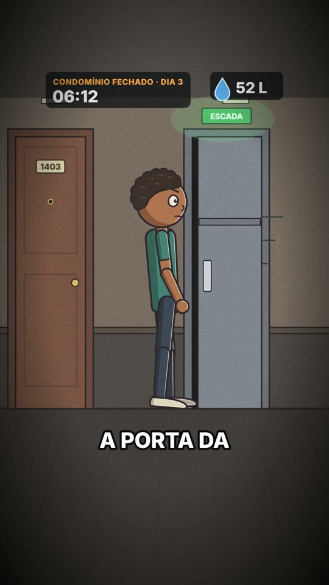
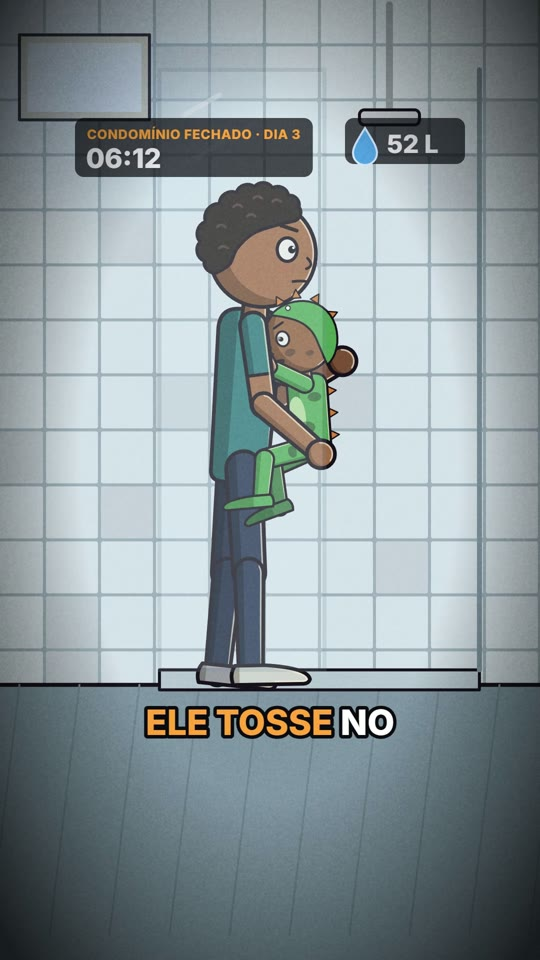
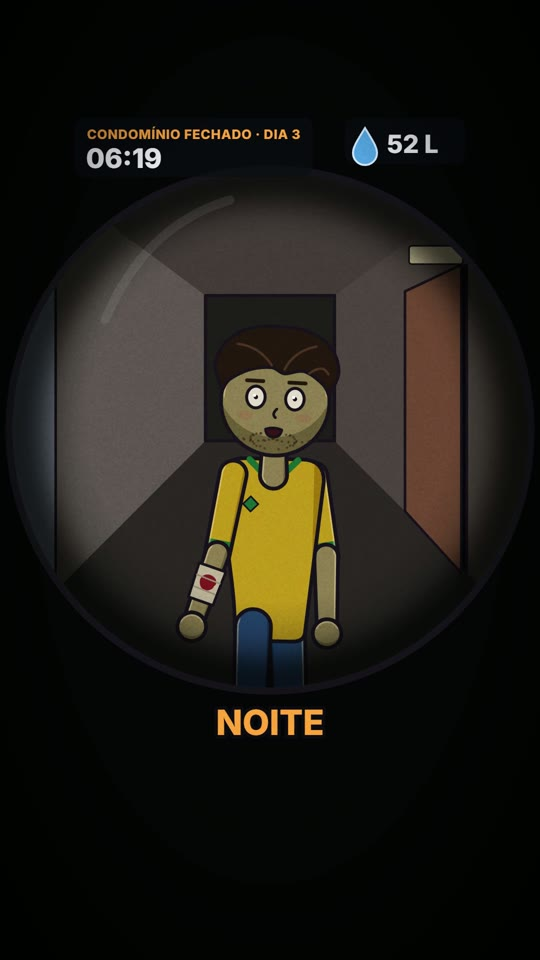
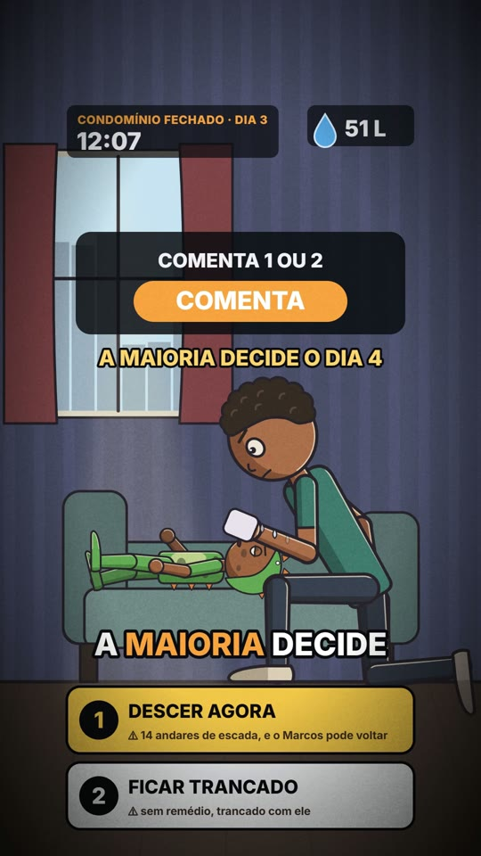

# Estilo Série Animada

Vídeo só de animação, sem a pessoa em cena, contando uma **história em episódios** com bonecos de traço de nanquim: narração em segunda pessoa ("você abre a porta"), personagens desenhados para a história, cenários de verdade (um corredor, uma cozinha, uma rua), câmera sempre andando e, no fim, **duas escolhas para o público decidir nos comentários** o que acontece no episódio seguinte. Bom para perfil sem rosto que vive de história (suspense, sobrevivência, mistério, drama), em vídeos de 1 a 2 min.

   

Os quadros são do exemplo (`sa-exemplo.html`), uma série de sobrevivência num prédio. **Os personagens e os lugares do exemplo são só para ver como se faz:** cada história ganha os seus.

## A história

- **Segunda pessoa e presente:** quem assiste é o personagem principal. Frases curtas, uma ação por frase.
- **Cada episódio:** um gancho já no conflito, uma linha que lembra o que a maioria escolheu, um acontecimento que muda a situação, um "problema nº" (o que piorou) e duas opções **que pesam parecido**, cada uma com um risco escrito. Opção óbvia não gera comentário: se quase todo mundo escolheria a mesma, troque.
- **A opção tem que ser possível naquele momento:** se um perigo está na porta, a história tira ele de lá antes de oferecer "sair".
- **Um recurso que acaba** (água, bateria, comida, dinheiro) com um contador no alto, e o relógio da história.
- **O episódio 1** abre com uma linha que situa o mundo no lugar de "a maioria escolheu". Como escrever a história está em [roteiro.md](../referencias/roteiro.md) (a seção "Série").

## A voz

De IA ou gravada pela pessoa: um narrador sério e uma voz para cada personagem que fala. No texto (`.projetos/NOME/texto.txt`), uma fala por linha: linha sem marcação é do narrador, `[nome] fala` é do personagem, e `[pausa 0.6]` sozinha numa linha dá o silêncio depois da fala de cima (antes de uma revelação, 0,6 a 0,9 s). No `meu-estilo/marca.json`:

```json
{ "vozes": { "narrador": { "id": "VOZ_DO_NARRADOR", "velocidade": 1.155 }, "maria": { "id": "VOZ_DA_MARIA", "velocidade": 1.05 } } }
```

**Gravada pela pessoa** (o narrador e os personagens na voz dela, ou de quem ela chamar): o mesmo texto marcado e `python .ferramenta/sistema/editar.py falas-gravadas .projetos/NOME/texto.txt AUDIOS... --saida .projetos/NOME/corte`. Os áudios vêm num só, com todas as falas na ordem do texto (quem fala sai da ordem do roteiro); um por personagem, com o nome dele no arquivo (`narrador.m4a`, `cida.m4a`); ou um por fala, na ordem. Cada gravação perde as pausas, as vozes ficam no mesmo volume e o `[pausa]` do texto vale entre as falas. Sai o mesmo da voz de IA, com `quem` e `fala` em cada palavra. Peça uma leitura séria e sem pressa: o suspense vem das pausas do texto.

**Voz de IA** (ver [voz-de-ia.md](../referencias/voz-de-ia.md)). Narrador lento cansa: ele vai uns 15% mais rápido que os personagens. Escreva o texto como vai aparecer na tela ("1405", "23%") e ponha a fala num `pronuncia.md` ("catorze zero cinco"): a legenda mostra o número e a voz fala por extenso. **O que vale só para esta história** ("1" falado "um" na escolha) vai no `pronuncia.md` ao lado do texto, em `.projetos/NOME/`; o `meu-estilo/pronuncia.md` vale para todos os vídeos da pessoa. O nome entre colchetes não tem espaço (`[cida]`, igual à chave em `"vozes"`); o nome que aparece na etiqueta da legenda vai em `S.legenda({ nomes: { cida: { nome: 'DONA CIDA', cor: '#8e3a4a' } } })`. Sons de história que o kit não tem (tosse, porta rangendo, passos, chuva): `python .ferramenta/sistema/editar.py efeito "descrição em inglês" --saida .projetos/NOME/sons/nome.wav --segundos 3`. Gera uma vez e reaproveita nos outros episódios.

## Na tela

- **Um bloco só, do começo ao fim** (`"tipo": "bloco"`, `x` 0, `y` 0, `largura` 1080, `"esconde_legenda": true`), com os planos dentro: cada plano é um momento da história, `{ini, fim, montar(g)}`, e o `montar` devolve o desenho de cada quadro a partir do tempo. Troca de plano por dissolve; **corte seco só no susto** (`corte: true`), com um clarão.
- **Personagens de perfil**, com um olho só e cabelo com volume. **Uma vista por personagem:** andando ou fazendo algo, sempre de perfil; de frente só parado, olhando para a câmera, e de frente sem inclinar (o giro do perfil vira um tombo para o lado). Mudar de vista entre cenas muda até o cabelo.
- **Escala real:** porta de uns 2,1 m e gente de uns 83% dela (`K.escala(altPorta, ficha)`), e **ninguém flutuando:** os pés no chão (`K.pe(ficha, chao, esc)`). Sentado, o quadril encosta no assento.
- **A perna anda o que o corpo anda:** `S.caminhada(posDe, t, ...)` tira o passo da distância percorrida. Corpo parado, perna parada; a perna nunca dispara quando a velocidade muda.
- **O que o personagem carrega continua com ele** em todas as cenas, até ele largar (e onde ele larga, fica): um galão que some entre a escada e o hall e volta depois quebra a história.
- **Zumbi (ou monstro) precisa parecer um:** só a pele de outra cor parece gente. Olheira escura, olho amarelado sem brilho, pupila pequena, boca torta, marcas na roupa e a ferida que explica a transformação.
- **Close de mão:** a palma atrás do objeto, as pontas dos dedos dobrando sobre a borda (com unha), o polegar do outro lado e o pulso da largura da palma. Dedos como retângulos soltos ao lado do objeto ficam feios.
- **Nada de membro solto:** braço, mão e objeto na mão saem do próprio boneco (`pecas.bracoF.prop`). O close de uma mão é desenhado inteiro, com a manga da roupa do personagem.
- **A mão num ponto da cena** (a maçaneta, a lanterna, o rosto de alguém): `bracoF: { mao: Boneco.maoEm(pose, ficha, [x, y]), dobra: 1 }`, com a pose já tendo x, y, esc, vira (e quadrilY e achata, se usar). No pé, o alvo é o tornozelo e o joelho para a frente pede `dobra: -1`.
- **Onde a mão está agora:** `Boneco.ondeEsta(boneco, 'bracoF', g)`, depois do `posar`. É de onde sai a luz da lanterna ou do celular: `K.facho(g, { alcance, abertura }).quadro(Boneco.ondeEsta(...), angulo, forca)`, um cone nítido com o círculo de luz onde bate, apontado para onde o personagem olha.
- **Objeto que você põe na mão depois do `criar` não recebe a cor da luz da cena.** Isso é bom para o que é fonte de luz (lanterna, tela do celular, vela, com o facho desenhado junto); objeto comum ganha a cor no quadro, com `Boneco.mul(cor, ambiente)`, ou entra nos `detalhes` da ficha.
- **Vestido e saia:** `Boneco.pessoa({ vestido: true, saia: '#cor', comprimento: 'curto' | 'joelho' | 'longo' })`. A saia é uma peça só sobre as duas coxas e segue os joelhos (ou os tornozelos, no longo); sentada, cobre o colo. A canela fica de pele (ou de meia, com `canela`).
- **Criança no colo:** de lado, sentada no antebraço da frente, virada para o peito de quem carrega, sem cobrir o rosto dele; o outro braço nas costas dela (ver `noColo` e `poseColo` no exemplo).
- **Luz com fonte:** toda luz sai de algo na cena (janela, lâmpada, celular, fogo), e a cor dela tinge o personagem (o último argumento do `Boneco.posar`). **E o facho vai para onde o personagem olha e aponta:** lanterna, celular e farol saem da mão para a frente dele; confira no quadro (no teste do sítio, a lanterna da vizinha apontou para o lado errado).
- **Bicho** (`sa-bicho.js`): `Bicho.cachorro({ cor, mancha, orelha: 'caida' | 'empe', porte: 'pequeno' | 'medio' | 'grande', coleira, perna })` e `Bicho.gato({...})`, sempre de perfil (`perna: 1.2` engrossa a perna). `Bicho.escala(altPorta, ficha)` dá o tamanho ao lado de uma porta; andando, o passo sai da distância (`S.caminhada` com `Bicho.passada(ficha, esc)`); `sentado`, `deitado`, `boca` (latido), `rabo` e `abana`, `orelha`, `cabeca`, `achata`; com `medo`, a orelha vai para trás. **O latido preso ao som:** `python .ferramenta/sistema/editar.py picos sons/latido.wav` diz quando cada latido começa no arquivo, e `Bicho.latido(t, picos, inicioDoSom)` dá a abertura da boca (use também no `achata`).
- **Enquadramento com as peças fixas:** o selo e o contador ocupam de 236 a 354 px; o cartão do problema, de 446 a 700; a legenda, de uns 1400 a 1500; os botões da escolha, de 1540 a 1860. Enquanto cada um estiver na tela, a câmera deixa o rosto e a ação fora dessas faixas.
- **As peças da série** (`sa-base.js`): selo com o nome da série e o relógio (`S.selo`), contador do recurso (`S.contador`, que pula quando o valor muda), cartão "PROBLEMA Nº" (`S.cartao`), legenda de 2 ou 3 palavras com as palavras-chave na cor da série (`S.legenda`) e os botões da escolha com o risco embaixo (`S.escolha`). Tudo a 150 px das laterais e abaixo de 220 px.
- **Diagrama** (o prédio em corte, um mapa): o ponto anda sobre a mesma linha desenhada, sem voltar e sem deixar rastro.

## Personagens e lugares novos

Cada história tem os seus, criados a partir do roteiro, num arquivo do projeto (`elenco.js`), e **os mesmos em todos os episódios**:

1. Para cada personagem, uma ficha com `Boneco.pessoa({...})`: pele, roupa, cabelo (`crespo`, `curto`, `topete`, `comprido`, `armado`, `careca`), idade (`crianca`, `idoso`) e **uma marca forte** em `detalhes` (o boné, os bobes, o curativo, a estampa). Nunca dois personagens parecidos, e figurante variado (nunca um personagem da história como figurante).
2. Cada lugar é uma função do projeto que monta as peças do `sa-cenario.js`: dentro de casa (`K.parede`, `K.chao`, `K.porta`, `K.janela` com vista de prédios ou do campo, `K.sofa`, `K.mesa`, `K.azulejo`, `K.luminaria`, `K.portaPorDentro`, `K.olhoMagico`), fora (`K.ceu` com lua e estrelas, `K.morro`, `K.grama`, `K.estrada` em fuga ou `atravessa: true` de lado a lado, `K.cerca`, `K.arvore`, `K.plantacao` com `escala` (0,3 para o milho de longe), que balança e `mexe(x)` onde alguma coisa passa, `K.casa` vista de fora, com a porta e as janelas que acendem) e o diagrama (`K.corte`). A porta de casa de sítio: `K.porta({ fresta: true, tramela: true })` e `porta.estufa(k, t)` quando empurram de fora. A janela mostra o que a história pede lá fora com `vista: (g, {x, y, w, h}) => ...` (o milharal, a casa da vizinha), recortado nela e devolve um grupo `atores` para os personagens. Confira a escala de cada lugar novo.
3. Mudança no personagem ao longo da série (machucado, sujeira, doença) é uma ficha nova que estende a dele (`Object.assign({}, ELENCO.fulano, {...})`).

## Movimento

Os princípios valem aqui mais do que em qualquer estilo, porque é personagem. No `movimento.md` do projeto, uma linha por cena (ver [EDITAR.md](../EDITAR.md), passo 3 de "Montar"), e as ferramentas do `sa-base.js`: `S.antes()` (antecipação: agachar antes de levantar, recuar antes de virar), `achata` na pose com `S.impacto()` e `S.susto()` (o peso, o pouso, o susto), `S.arco()` (o braço e a cabeça em curva), `S.segue()` (a cabeça que vem depois do corpo) e o olho reagindo (`medo`, `desconfia`, `pisca` segurado no susto).

## Som

Sem música. Efeitos presos às palavras, sempre por baixo da voz: som curto de 11 a 15 dB abaixo, som contínuo uns 20 dB abaixo e acabando com a cena (`"ate"`). **Som de ambiente (grilos, vento, chuva) só no trecho que pede e bem baixo, nunca o vídeo inteiro:** grilos altos do começo ao fim incomodam muito. Para um som tocar de novo, ponha outra camada `som`. Um tambor grave em cada cartão de problema e o único impacto pesado no corte seco. Com voz de IA, `"efeitos": {"ganho": -6}`. **Para acertar o volume,** rode o `escutar` (passo "Conferir" do EDITAR.md): ele diz quanto cada efeito ficou abaixo da voz; baixe o `ganho` do efeito pela diferença até a régua.

## Como montar

1. A história, a voz (`voz` com o texto marcado, ou `falas-gravadas` com a gravação dela) e os sons de história que faltarem.
2. O `elenco.js` e os lugares, a partir do roteiro; o `movimento.md`.
3. A cena: copie a estrutura do `sa-exemplo.html` (as inclusões, `SA.cena`, `Cenario.kit`, os planos, as peças da série e o `S.ligar(S.filme(planos), tl, t0, D)` no fim), com `<!--#inclui sa-base.css-->` no `<style>` e, no `<script>`, `<!--#inclui sa-personagem.js-->`, `<!--#inclui sa-bicho.js-->` (se tiver bicho), `<!--#inclui sa-base.js-->`, `<!--#inclui sa-cenario.js-->` e `<!--#inclui elenco.js-->`. O tempo de cada momento vem da fala: `S.em(i, 'palavra')` (quando a palavra começa na fala i; a palavra igual vale antes da parecida) e `S.ate(i, 'palavra')`. O número de cada fala sai de `python .ferramenta/sistema/editar.py falas .projetos/NOME/corte/palavras.json`. Um erro num plano aparece no console com o número do plano.
4. O `roteiro.json`:

```json
{ "efeitos": { "ganho": -6 },
  "camadas": [
    { "tipo": "bloco", "arquivo": "episodio.html", "de": 0, "ate": 95.4, "x": 0, "y": 0, "largura": 1080, "esconde_legenda": true, "som": false },
    { "tipo": "som", "em": "@tosse", "arquivo": "sons/tosse.wav", "ganho": -4 },
    { "tipo": "som", "em": "@panela", "arquivo": "sons/panela.wav", "ate": "@corredor", "ganho": -5 },
    { "tipo": "som", "em": "@problema", "id": "cinematic-drum-big", "ganho": 6 } ] }
```

5. `montar`, olhar os quadros com o `movimento.md` aberto (escala, pés no chão, mãos onde devem estar, ninguém cortado, nada a menos de 150 px das laterais), `renderizar`, `finalizar`. O vídeo acaba 1 s depois da última fala.
