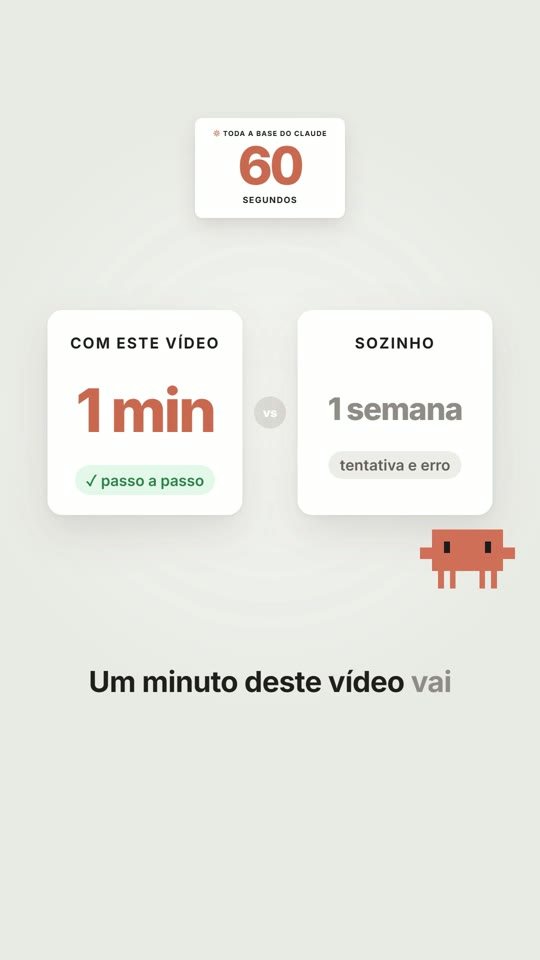
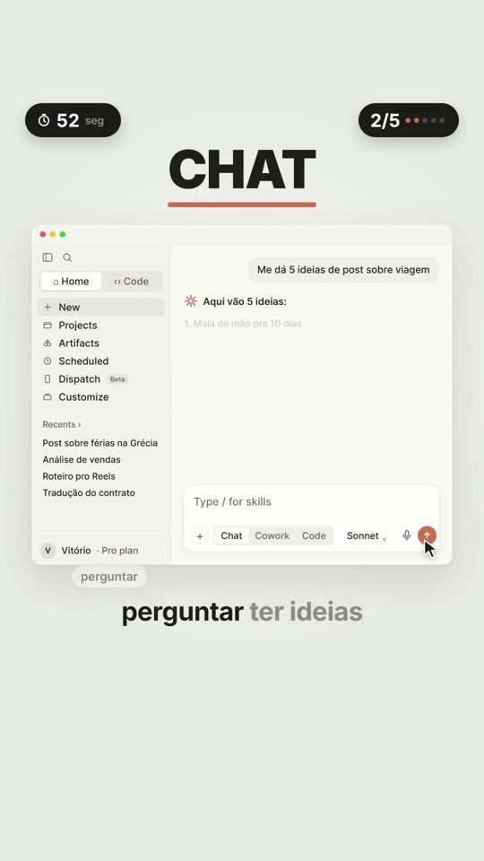
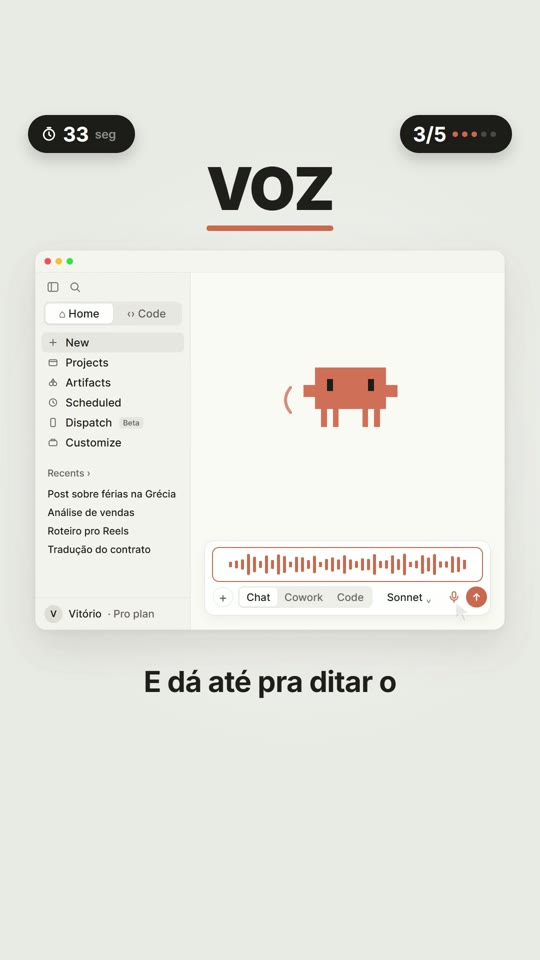
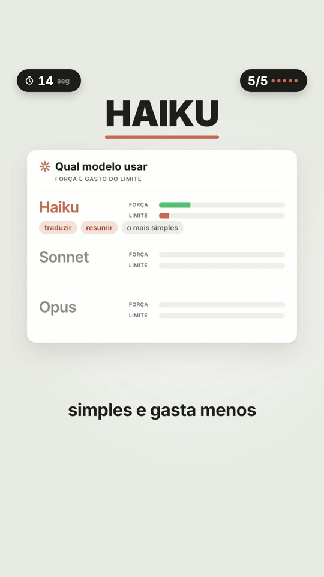

# Estilo Tela do Claude

Vídeo só de animação, sem a pessoa em cena, sobre a voz: **o app do Claude, copiado tela por tela, é o palco do vídeo inteiro**, e cada parte da fala é uma ação dentro dele. Feito para vídeo que ensina a usar o Claude ou o Claude Code (o guia rápido, a dica de recurso, o "tudo o que você precisa saber"). Fundo claro e o laranja do Claude como única cor forte.

   

## A voz

Gravada pela pessoa ou de IA (ver [voz-de-ia.md](../referencias/voz-de-ia.md)). **Gravada pela pessoa:** o áudio do celular (o gravador de voz serve; m4a, mp3 ou wav), posto em `brutos/`. Ele passa pelo `transcrever` e pelo `cortar`, como um vídeo: saem as pausas, entra o tratamento de voz, e o vídeo de base é preto, com a duração exata da voz. O tempo de cada palavra é o da gravação. Com a voz dela, peça para gravar num ritmo animado: o estilo pede fala rápida. **Um pouco mais rápida que no Motion:** com voz de IA, `"velocidade": 1.08` no `meu-estilo/marca.json` (na velocidade normal, o estilo fica lento). Nomes em inglês (Cowork, Code, Haiku, Sonnet, Opus) vão para a pronúncia antes de gerar.

## Na tela

- **Fundo bege-cinza claro**, o vídeo inteiro: `"arquivo": "tc-fundo.html"`, primeiro, do início ao fim. Ele traz a base `tc-base.css`, que também muda a legenda para este estilo.
- **O app do Claude, fiel ao de verdade:** barra lateral (Home/Code, New, Projects, Artifacts, Scheduled, Dispatch, Customize, as conversas recentes, o usuário), a saudação "What shall we think through?" com o asterisco, e a caixa de pedido com o +, as abas Chat, Cowork e Code, o modelo, o microfone e o enviar. Letra fina, como no app. Confira no app atual os nomes das abas e dos modelos: eles mudam com as atualizações.
- **Cada parte da fala é uma ação dentro do app,** no tempo da palavra: o cursor clica na aba, o pedido é digitado e a resposta chega, o seletor de pasta abre, os anexos entram na caixa, a caixa vira a onda da voz, o projeto é criado e recebe os arquivos, o seletor de modelos abre. Quando a ação sai do app (o editor de código, o site pronto), o app some e volta depois. Uma cena só (`tc-app.html` é o exemplo inteiro) carrega todas as ações, para o app nunca piscar.
- **Uma palavra grande por parte, sublinhada em laranja,** acima do app (`tc-titulo.html`, com a lista das palavras e uma marca para cada).
- **O cronômetro e o progresso no alto,** em pílulas escuras (`tc-hud.html`): o cronômetro desce de 60 a 0 um pouco mais rápido que o relógio, para zerar no fim do conteúdo, e o progresso avança a cada parte ("1/5" a "5/5"). Combina com o roteiro em lista ("as cinco bases", "em 60 segundos").
- **Por fora do app, poucos elementos, em cartões brancos de sombra macia:** o cartão do gancho que conta até 60 (`tc-gancho.html`), a comparação "com este vídeo" contra "sozinho", as barras de comparação, as pílulas do que dá para fazer, o cartão de escolha com barras (`tc-modelos.html`), a lista final com checks e o cartão do perfil com o botão Seguir.
- **O mascote de pixel** laranja, andando no lugar em degraus, nas cenas sem app.
- **As cenas se emendam:** o cartão do gancho vira o cronômetro, o seletor de modelos vira o cartão dos modelos, o cartão vira a lista e a lista vira o perfil (`vira()` do `mo-base.js`).
- **Legenda karaokê embaixo do app,** escura e sem sombra, as palavras que ainda vêm em cinza e a palavra-chave sublinhada: `"legenda": {"modo": "karaoke", "classe": "leg-forte", "cor": "#1f1e1c", "x": 110, "largura": 860, "y": 1330, "caracteres": 26, "destaques": [...]}`.
- **Contraste:** os cinzas do app de verdade são claros demais para o conferidor de leitura, que trava o render. Os da base já estão no limite que passa; cinza novo, comece por `var(--tc-apagado)`.
- **Área:** o app de x 70 a 1010 e de y 500 a 1260, a palavra grande em y 318, as pílulas em y 230 e a legenda em y 1330.

## Som

Sem música. Um efeito em cada ação: clique nos cliques do cursor, teclado na digitação, pop nas pílulas e nos anexos, contagem nas barras, um blip a cada parte do progresso, swish nas emendas. Com voz de IA, `"efeitos": {"ganho": -6}`.

## Como montar

1. A voz, já na velocidade do estilo, em `.projetos/NOME/corte/` (`voz` com a de IA; `transcrever` e `cortar` com a gravada).
2. No `roteiro.json`, nesta ordem: `tc-fundo.html` (início ao fim), o gancho, `tc-hud.html` (do fim do gancho até o fim do conteúdo), `tc-titulo.html` (da primeira palavra até o fim), a cena do app, as cenas de fora do app e o final. Todas com `"som": false` e os efeitos em `"sons"`, porque o clique padrão de entrada de camada cairia em cima das ações.
3. Em cada cena, `<!--#inclui tc-base.css-->` no `<style>` e, no `<script>`, `<!--#inclui mo-base.js-->` seguido de `<!--#inclui tc-base.js-->` (asterisco, mascote, cursor, palavra grande, ondas da voz).
4. `montar`, olhar os quadros nas ações e nas emendas, `renderizar`, `finalizar`.
